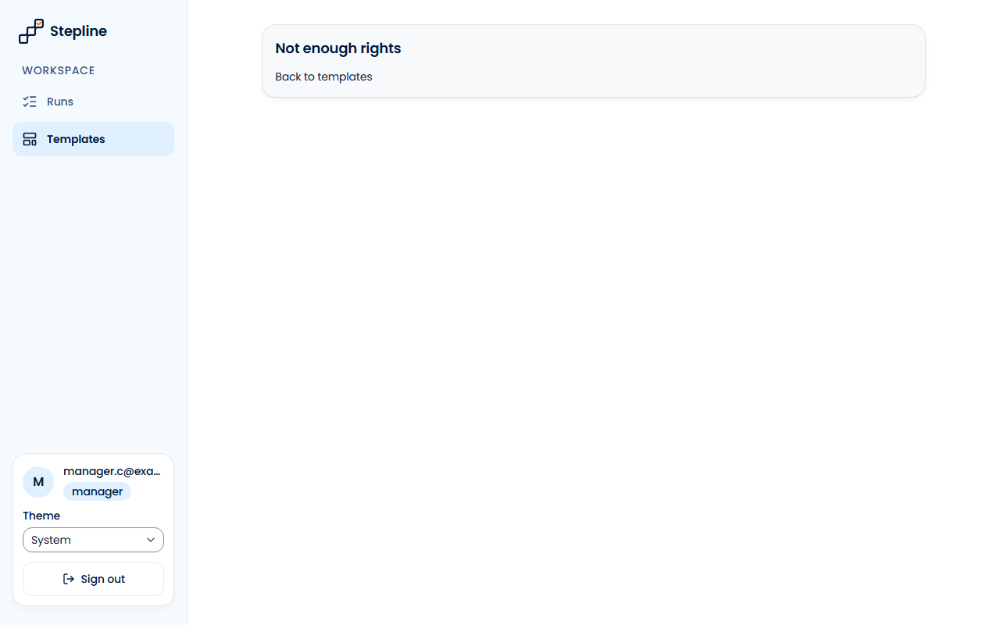
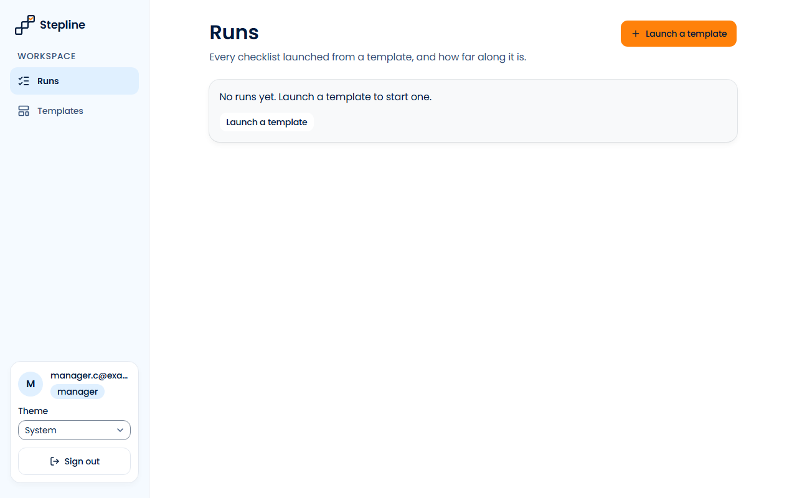
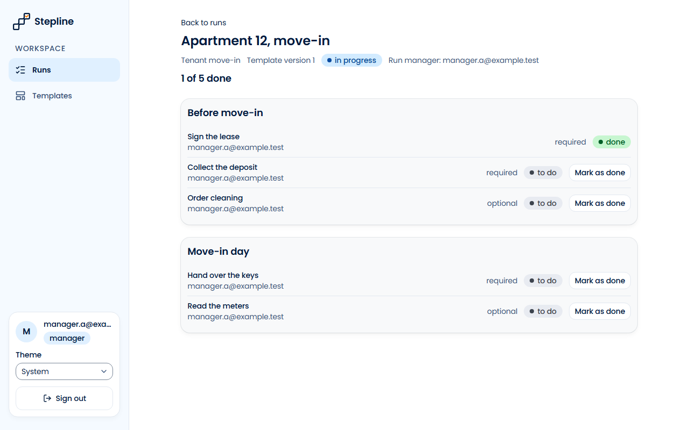

# Звіт UAT — 02.11.2026

- **Застосунок:** https://property-workflows-bravo16.vercel.app (/api/health: коміт `a039c9c`)
- **Код тестів:** `task/uat` @ `6d7afe6`
- **Прогін:** 02.11.2026, 14:41 (Київ), Playwright 49.5 с; AC: 3 — PASS 3, FAIL 0, NEEDS-HUMAN 0
- **Рецензент:** `claude-haiku-5-5`; суперечки → `claude-sonnet-5-5`. Разом за розбір: $0.0066 (ціни API; за підпискою — у межах ліміту плану)
- **Прибирання:** синтетичних uat-*@example.test видалено 0, лишилось 0, їхніх рядків, що лишились: 0
- **Відео й траси:** не в git — `test-results/` локально або артефакт CI; трасу відкриває `npx playwright show-trace <trace.zip>`

| AC | Перевірки | Агент | Підсумок | Чому | Playwright | Розбір |
|---|---|---|---|---|---|---|
| AC-DSYS-02 | пройшли | Haiku: PASS | **PASS** | R6: перевірки, агент і цитати збігаються | 12.0 с | $0.0024, 14.6 с |
| AC-DSYS-04 | пройшли | Haiku: PASS | **PASS** | R6: перевірки, агент і цитати збігаються | 5.0 с | $0.0022, 8.6 с |
| AC-DSYS-08 | пройшли | Haiku: PASS | **PASS** | R6: перевірки, агент і цитати збігаються | 9.4 с | $0.0021, 8.3 с |

## AC-DSYS-02 — PASS

**Тест:** AC-DSYS-02: менеджер відкриває редактор «Tenant move-in» за прямим посиланням — «Not enough rights» і «Back to templates», без вмісту редактора, шаблон лишається на версії 1

**Критерій** (requirements/19-use-one-design-system.md):

> AC-DSYS-02: Given manager B signed in and the template "Tenant move-in" with current version 1. When B opens the editor of this template by a direct link. Then B sees the message "Not enough rights" and the link "Back to templates" in the same page layout as the other pages, no content of the editor, and the template stays at version 1 with no unpublished changes.

**Кроки:** ✔ Дано: manager B (manager.c@example.test) signed in and the template "Tenant move-in" with current version 1 → ✔ Коли: B opens the editor of this template by a direct link → ✔ Тоді: B sees the message "Not enough rights" and the link "Back to templates" in the same page layout as the other pages, no content of the editor, and the template stays at version 1 with no unpublished changes

**Агент (claude-haiku-5-5, PASS):** На кадрі видно картку з написом «Not enough rights» і посиланням «Back to templates», а ліворуч бічну панель із «Stepline», «Runs» і «Templates» (пункт «Templates» підсвічено). Редактора, полів чи кнопки «Save version» на кадрі немає. Порівняти з іншими сторінками за одним кадром неможливо, тож твердження «та сама компоновка» перевірено лише за наявністю бічної панелі; решта частин «Тоді» (WORKSPACE, картка користувача, версія 1) — поза межами кадру і не оцінювалась.

**Цитати агента, звірені зі сторінкою (aria):**
- «Not enough rights» — є на сторінці
- «Back to templates» — є на сторінці
- «Stepline» — є на сторінці
- «Runs» — є на сторінці
- «Templates» — є на сторінці

**Правило:** R6: перевірки, агент і цитати збігаються

**Відео:** `test-results/artifacts/editor-forbidden-AC-DSYS-0-10305-аблон-лишається-на-версії-1-chromium/video.webm` · **траса:** `test-results/artifacts/editor-forbidden-AC-DSYS-0-10305-аблон-лишається-на-версії-1-chromium/trace.zip` (не в git)

**Рішення PM:** ☐ приймаю · ☐ відхилення від вимог (issue «Відхилення від вимог: AC-DSYS-02 — …») · @login: ____

## AC-DSYS-04 — PASS

**Тест:** AC-DSYS-04: менеджер без запусків відкриває список запусків — «No runs yet. Launch a template to start one.» і «Launch a template», без таблиці

**Критерій** (requirements/19-use-one-design-system.md):

> AC-DSYS-04: Given manager B who has no runs. When B opens the list of runs. Then B sees the message "No runs yet. Launch a template to start one." and the link "Launch a template", and no empty table.

**Кроки:** ✔ Дано: manager B (manager.c@example.test) who has no runs → ✔ Коли: B opens the list of runs → ✔ Тоді: B sees the message "No runs yet. Launch a template to start one." and the link "Launch a template", and no empty table

**Агент (claude-haiku-5-5, PASS):** На кадрі /runs для користувача manager.c@exa... (роль manager) видно повідомлення «No runs yet. Launch a template to start one.» і посилання «Launch a template» під ним, у сірій картці. Таблиці на кадрі немає; частина «no empty table» не з кадрів і не оцінювалась.

**Цитати агента, звірені зі сторінкою (aria):**
- «No runs yet. Launch a template to start one.» — є на сторінці
- «Launch a template» — є на сторінці

**Правило:** R6: перевірки, агент і цитати збігаються

**Відео:** `test-results/artifacts/runs-empty-AC-DSYS-04-мене-17849-nch-a-template»-без-таблиці-chromium/video.webm` · **траса:** `test-results/artifacts/runs-empty-AC-DSYS-04-мене-17849-nch-a-template»-без-таблиці-chromium/trace.zip` (не в git)

**Рішення PM:** ☐ приймаю · ☐ відхилення від вимог (issue «Відхилення від вимог: AC-DSYS-04 — …») · @login: ____

## AC-DSYS-08 — PASS

**Тест:** AC-DSYS-08: відвідувач відкриває «Apartment 12, move-in» за прямим посиланням, бачить вхід і входить як менеджер запуску — сторінка цього запуску

**Критерій** (requirements/19-use-one-design-system.md):

> AC-DSYS-08: Given a visitor who is not signed in, and manager B who is the run manager of the run "Apartment 12, move-in". When the visitor opens the page of this run by a direct link, sees the sign-in page and signs in as B. Then B sees the page of the run "Apartment 12, move-in".

**Кроки:** ✔ Дано: a visitor who is not signed in, and manager B (manager.a@example.test) who is the run manager of the run "Apartment 12, move-in" → ✔ Коли: the visitor opens the page of this run by a direct link, sees the sign-in page and signs in as B → ✔ Тоді: B sees the page of the run "Apartment 12, move-in"

**Агент (claude-haiku-5-5, PASS):** На кадрі frame-then-1.png видно сторінку запуску із заголовком «Apartment 12, move-in», посимвольно збігається з критерієм. Під заголовком показано «Run manager: manager.a@example.test» і список кроків запуску, тож це сторінка самого запуску, а не список запусків. Частини про адресу сторінки та вхід як B не з кадрів, тому не оцінювалися.

**Цитати агента, звірені зі сторінкою (aria):**
- «Apartment 12, move-in» — є на сторінці

**Правило:** R6: перевірки, агент і цитати збігаються

**Відео:** `test-results/artifacts/return-after-sign-in-AC-DS-72ec0-ку-—-сторінка-цього-запуску-chromium/video.webm` · **траса:** `test-results/artifacts/return-after-sign-in-AC-DS-72ec0-ку-—-сторінка-цього-запуску-chromium/trace.zip` (не в git)

**Рішення PM:** ☐ приймаю · ☐ відхилення від вимог (issue «Відхилення від вимог: AC-DSYS-08 — …») · @login: ____

## Як читати підсумок

- **PASS** — автоматичні перевірки пройшли, агент-рецензент погодився з кадром, а кожну його цитату знайдено на сторінці.
- **FAIL** — впала автоматична перевірка. Агент цього не перекриває: невидимі вади (буфер обміну, база) він на кадрі не побачить.
- **NEEDS-HUMAN** — перевірки зелені, але агент не погодився або його цитати немає на сторінці. Часто це слабкий тест або розбіжність між текстом AC і тестом — питання до PM, а не обов'язково вада продукту.

Правила: R1: перевірка впала — FAIL завжди, агент не перекриває; R2: немає вердикту агента або кадру; R3: перевірки пройшли, агент не погоджується — вирішує людина; R4: цитати агента немає на сторінці (aria) — не підтверджено; R5: помилка сторінки або 5xx під час сценарію; R6: перевірки, агент і цитати збігаються.
