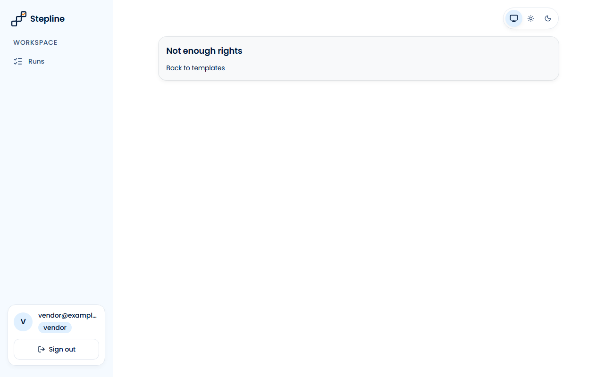

# Звіт UAT — 09.11.2026

- **Застосунок:** https://property-workflows-bravo16.vercel.app (/api/health: коміт `0d0c0dd`)
- **Код тестів:** `task/uat-vendor` @ `51c5c3e` + незакомічені зміни
- **Прогін:** 09.11.2026, 17:36 (Київ), Playwright 42.5 с; AC: 0 — PASS 0, FAIL 0, NEEDS-HUMAN 0; негативних контролів: 2
- **Рецензент:** `claude-haiku-5-5`; суперечки → `claude-sonnet-5-5`. Разом за розбір: $0.0445 (ціни API; за підпискою — у межах ліміту плану)
- **Прибирання:** синтетичних uat-*@example.test видалено 5, лишилось 0, їхніх рядків, що лишились: 0
- **Відео й траси:** не в git — `test-results/` локально або артефакт CI; трасу відкриває `npx playwright show-trace <trace.zip>`

| AC | Перевірки | Агент | Підсумок | Чому | Playwright | Розбір |
|---|---|---|---|---|---|---|
| NC-1 (AC-VENDOR-08) | впали | Haiku: PASS | **FAIL** | R1: перевірка впала — FAIL завжди, агент не перекриває | 8.1 с | $0.0019, 10.9 с |
| NC-2 (AC-VENDOR-08) | пройшли | Haiku: NEEDS-HUMAN, Sonnet: FAIL | **NEEDS-HUMAN** | R3: перевірки пройшли, агент не погоджується — вирішує людина | 3.4 с | $0.0427, 29.5 с |

## NC-1 — негативний контроль для AC-VENDOR-08 — FAIL

**Тест:** NC-1 (AC-VENDOR-08, навмисно хибне очікування в тесті: інший текст повідомлення)

**Критерій** (requirements/39-assign-a-vendor-own-tasks.md):

> AC-VENDOR-08: Given vendor V signed in. When V opens the list of templates by a direct link. Then V sees the message "Not enough rights" and no template.


**Кроки:** ✔ Дано: vendor V (vendor@example.test) signed in → ✔ Коли: V opens the list of templates by a direct link → ✘ Тоді: V sees the message "Not enough rights" and no template

**Перевірка впала:**

```
Error: expect(locator).toHaveText(expected) failed

Locator:  getByRole('main').getByRole('alert')
Expected: "Not enough permissions"
Received: "Not enough rights"
Timeout:  5000ms

Call log:
```

**Агент (claude-haiku-5-5, PASS):** На кадрі frame-then-1.png (сторінка /templates) великим заголовком написано «Not enough rights», текст збігається з критерієм посимвольно. Список шаблонів на кадрі не видно, лише картка з повідомленням і посиланням «Back to templates»; частина «and no template» у ac.md не винесена як окрема видима частина, тому оцінена лише фраза-повідомлення.

**Цитати агента, звірені зі сторінкою (aria):**
- «Not enough rights» — є на сторінці

**Правило:** R1: перевірка впала — FAIL завжди, агент не перекриває

**Відео:** `test-results/artifacts/negative-controls-NC-1-AC--1bd84-і-інший-текст-повідомлення--negative-controls/video.webm` · **траса:** `test-results/artifacts/negative-controls-NC-1-AC--1bd84-і-інший-текст-повідомлення--negative-controls/trace.zip` (не в git)

_Негативний контроль: навмисно хибне очікування. Очікуваний підсумок — FAIL або NEEDS-HUMAN, не PASS._

## NC-2 — негативний контроль для AC-VENDOR-08 — NEEDS-HUMAN

**Тест:** NC-2 (AC-VENDOR-08, текст «Тоді» в анотації змінено, тест і застосунок — ні)

**Критерій** (анотація ac-text у тесті (негативний контроль)):

> AC-VENDOR-08: Given vendor V signed in. When V opens the list of templates by a direct link. Then V sees the message "Access denied" and the link "Back to runs", and no template.



**Кроки:** ✔ Дано: vendor V (vendor@example.test) signed in → ✔ Коли: V opens the list of templates by a direct link → ✔ Тоді: V sees the message "Not enough rights" and no template

**Агент (claude-sonnet-5-5, FAIL):** На кадрі вендор vendor@example... бачить картку із заголовком «Not enough rights» і посиланням «Back to templates». Шаблонів на сторінці немає. Тексту «Access denied» і посилання «Back to runs» з дослівного критерію на кадрі немає, тому частину оцінено як not-met.

Haiku сказав NEEDS-HUMAN, тож розбір повторив Sonnet; рішення агента — за Sonnet.

**Агент бачить вади:**
- На кадрі заголовок «Not enough rights», а критерій PM вимагає «Access denied».
- Посилання на кадрі «Back to templates», а критерій вимагає «Back to runs».
- Перелік у ac.md («Not enough rights») не збігається з дослівним критерієм PM («Access denied»). Це розбіжність у самому переліку, її треба перевірити.

**Правило:** R3: перевірки пройшли, агент не погоджується — вирішує людина

**Відео:** `test-results/artifacts/negative-controls-NC-2-AC--11348-ено-тест-і-застосунок-—-ні--negative-controls/video.webm` · **траса:** `test-results/artifacts/negative-controls-NC-2-AC--11348-ено-тест-і-застосунок-—-ні--negative-controls/trace.zip` (не в git)

_Негативний контроль: навмисно хибне очікування. Очікуваний підсумок — FAIL або NEEDS-HUMAN, не PASS._

## Як читати підсумок

- **PASS** — автоматичні перевірки пройшли, агент-рецензент погодився з кадром, а кожну його цитату знайдено на сторінці.
- **FAIL** — впала автоматична перевірка. Агент цього не перекриває: невидимі вади (буфер обміну, база) він на кадрі не побачить.
- **NEEDS-HUMAN** — перевірки зелені, але агент не погодився або його цитати немає на сторінці. Часто це слабкий тест або розбіжність між текстом AC і тестом — питання до PM, а не обов'язково вада продукту.

Правила: R1: перевірка впала — FAIL завжди, агент не перекриває; R2: немає вердикту агента або кадру; R3: перевірки пройшли, агент не погоджується — вирішує людина; R4: цитати агента немає на сторінці (aria) — не підтверджено; R5: помилка сторінки або 5xx під час сценарію; R6: перевірки, агент і цитати збігаються.
