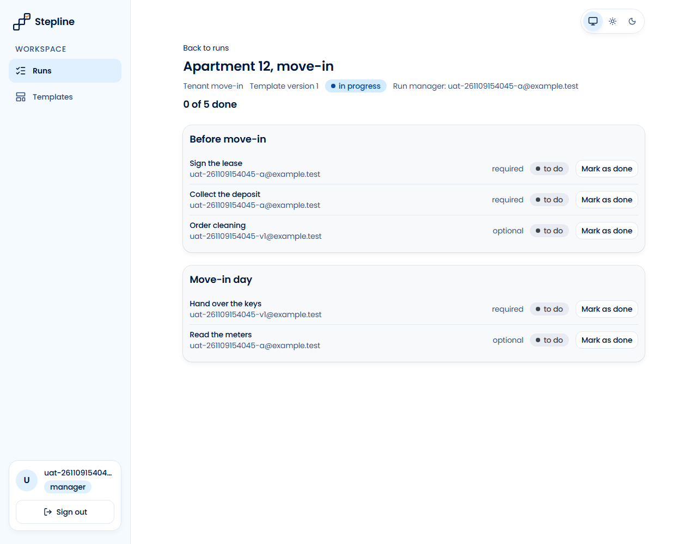
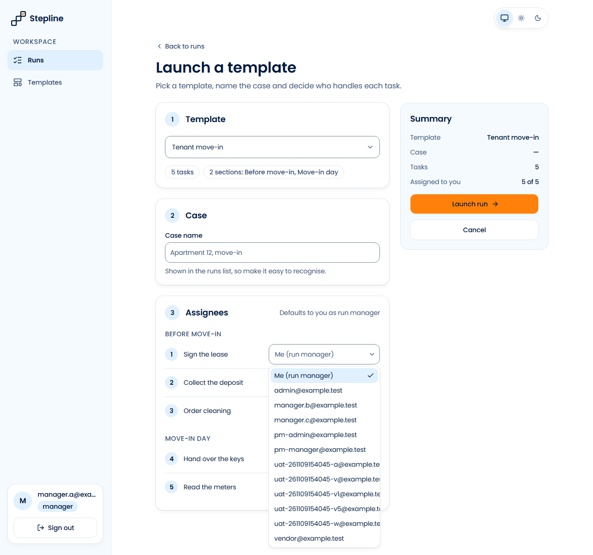
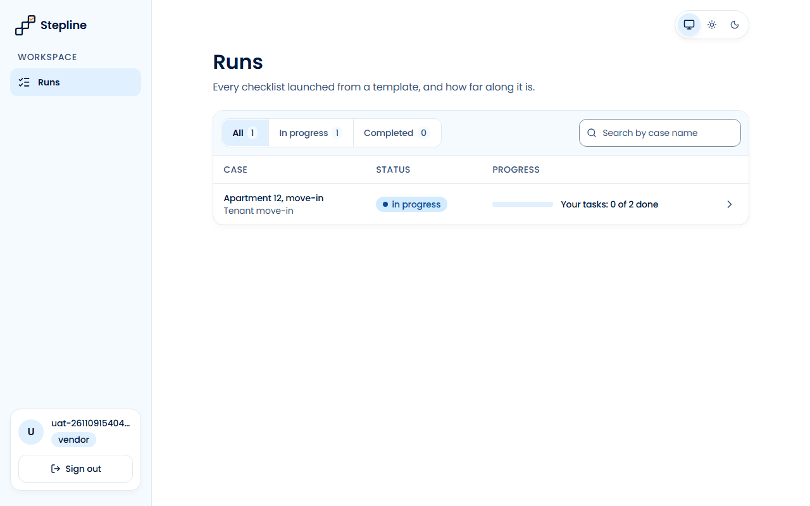
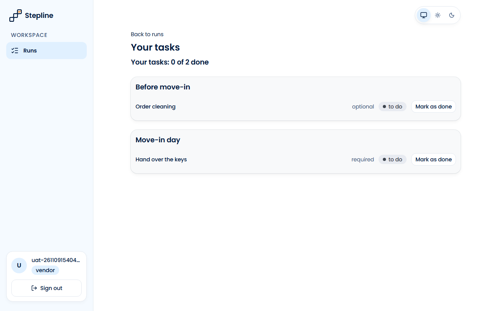
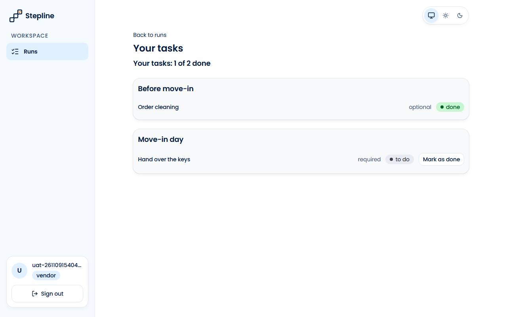
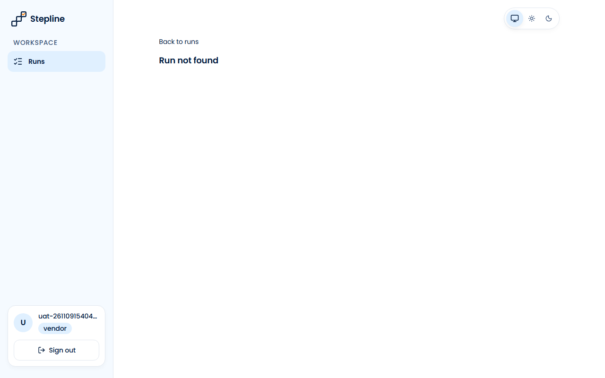
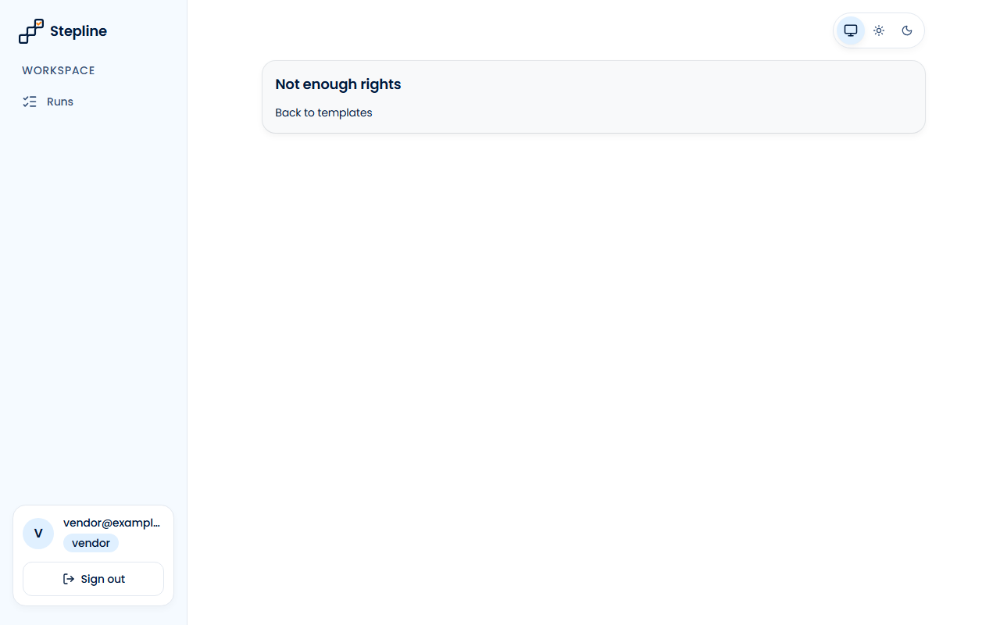
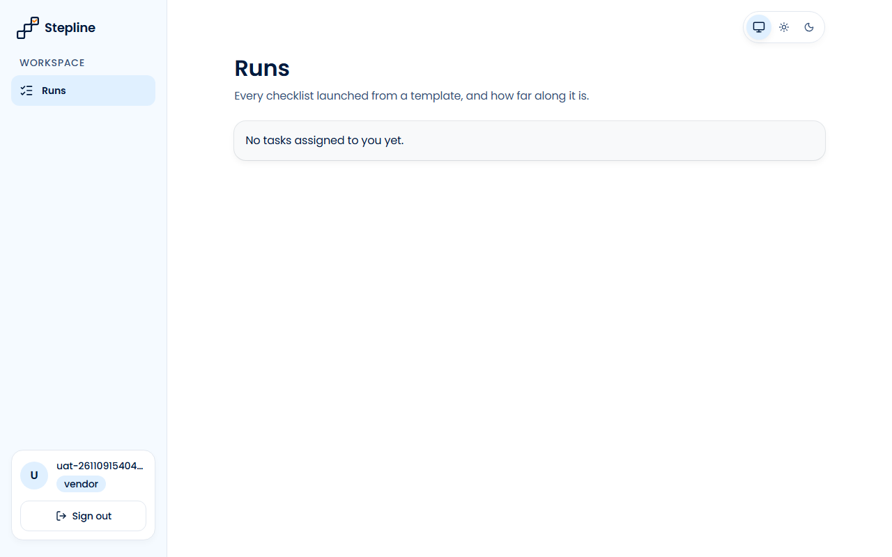

# Звіт UAT — 09.11.2026

- **Застосунок:** https://property-workflows-bravo16.vercel.app (/api/health: коміт `0d0c0dd`)
- **Код тестів:** `task/uat-vendor` @ `d810d5f`
- **Прогін:** 09.11.2026, 17:40 (Київ), Playwright 106.3 с; AC: 10 — PASS 10, FAIL 0, NEEDS-HUMAN 0
- **Рецензент:** `claude-haiku-5-5`; суперечки → `claude-sonnet-5-5`. Разом за розбір: $0.0195 (ціни API; за підпискою — у межах ліміту плану)
- **Прибирання:** синтетичних uat-*@example.test видалено 5, лишилось 0, їхніх рядків, що лишились: 0
- **Відео й траси:** не в git — `test-results/` локально або артефакт CI; трасу відкриває `npx playwright show-trace <trace.zip>`

| AC | Перевірки | Агент | Підсумок | Чому | Playwright | Розбір |
|---|---|---|---|---|---|---|
| AC-VENDOR-01 | пройшли | Haiku: PASS | **PASS** | R6: перевірки, агент і цитати збігаються | 18.4 с | $0.0025, 16.0 с |
| AC-VENDOR-02 | пройшли | Haiku: PASS | **PASS** | R6: перевірки, агент і цитати збігаються | 8.7 с | $0.0023, 14.8 с |
| AC-VENDOR-03 | пройшли | Haiku: PASS | **PASS** | R6: перевірки, агент і цитати збігаються | 3.5 с | $0.0019, 11.1 с |
| AC-VENDOR-04 | пройшли | Haiku: PASS | **PASS** | R6: перевірки, агент і цитати збігаються | 7.0 с | $0.0019, 10.6 с |
| AC-VENDOR-05 | пройшли | Haiku: PASS | **PASS** | R6: перевірки, агент і цитати збігаються | 8.4 с | $0.0018, 9.9 с |
| AC-VENDOR-06 | пройшли | Haiku: PASS | **PASS** | R6: перевірки, агент і цитати збігаються | 3.2 с | $0.0019, 13.0 с |
| AC-VENDOR-07 | пройшли | Haiku: PASS | **PASS** | R6: перевірки, агент і цитати збігаються | 6.7 с | $0.0020, 10.4 с |
| AC-VENDOR-08 | пройшли | Haiku: PASS | **PASS** | R6: перевірки, агент і цитати збігаються | 3.6 с | $0.0016, 8.1 с |
| AC-VENDOR-09 | пройшли | Haiku: PASS | **PASS** | R6: перевірки, агент і цитати збігаються | 5.4 с | $0.0018, 8.7 с |
| AC-VENDOR-10 | пройшли | Haiku: PASS | **PASS** | R6: перевірки, агент і цитати збігаються | 2.8 с | $0.0017, 9.3 с |

## AC-VENDOR-01 — PASS

**Тест:** AC-VENDOR-01: менеджер A запускає «Tenant move-in» і призначає вендора V виконавцем задач 3 і 4 — у задач 1, 2 і 5 виконавець A

**Критерій** (requirements/39-assign-a-vendor-own-tasks.md):

> AC-VENDOR-01: Given manager A, vendor V and the template "Tenant move-in" with 5 tasks. When A launches the template for the case "Apartment 12, move-in" and assigns V as the assignee of tasks 3 and 4. Then tasks 3 and 4 have V as the assignee, and tasks 1, 2 and 5 have A.

**Кроки:** ✔ Дано: manager A (uat-261109154045-a@example.test), vendor V (uat-261109154045-v1@example.test) and the template "Tenant move-in" with 5 tasks → ✔ Коли: A launches the template for the case "Apartment 12, move-in" and assigns V as the assignee of tasks 3 and 4 → ✔ Тоді: tasks 3 and 4 have V as the assignee, and tasks 1, 2 and 5 have A

**Агент (claude-haiku-5-5, PASS):** На кадрі frame-then-1.png сторінка запуску «Apartment 12, move-in» з п'ятьма завданнями у двох групах. Біля «Order cleaning» і «Hand over the keys» стоїть uat-261109154045-v1@example.test, а біля «Sign the lease», «Collect the deposit» і «Read the meters» — uat-261109154045-a@example.test, що відповідає критерію. Частини про структуру запуску та базу не оцінювались за правилами.

**Цитати агента, звірені зі сторінкою (aria):**
- «Order cleaning» — є на сторінці
- «uat-261109154045-v1@example.test» — є на сторінці
- «Hand over the keys» — є на сторінці
- «uat-261109154045-v1@example.test» — є на сторінці
- «Sign the lease» — є на сторінці
- «uat-261109154045-a@example.test» — є на сторінці
- «Collect the deposit» — є на сторінці
- «uat-261109154045-a@example.test» — є на сторінці
- «Read the meters» — є на сторінці
- «uat-261109154045-a@example.test» — є на сторінці

**Правило:** R6: перевірки, агент і цитати збігаються

**Відео:** `test-results/artifacts/vendor-assign-at-launch-AC-087c3--задач-1-2-і-5-виконавець-A-chromium/video.webm` · **траса:** `test-results/artifacts/vendor-assign-at-launch-AC-087c3--задач-1-2-і-5-виконавець-A-chromium/trace.zip` (не в git)

**Рішення PM:** ☐ приймаю · ☐ відхилення від вимог (issue «Відхилення від вимог: AC-VENDOR-01 — …») · @login: ____

## AC-VENDOR-02 — PASS

**Тест:** AC-VENDOR-02: менеджер A відкриває вибір виконавця — email B, адміністратора й V, без імен, ролей і інших даних профілю

**Критерій** (requirements/39-assign-a-vendor-own-tasks.md):

> AC-VENDOR-02: Given managers A and B, an administrator and vendor V, and A launching a template. When A opens the assignee picker. Then A sees the emails of B, of the administrator and of V, and no names, roles or other profile data.

**Кроки:** ✔ Дано: managers A (manager.a@example.test) and B (manager.b@example.test), an administrator (admin@example.test) and vendor V (vendor@example.test), and A launching a template → ✔ Коли: A opens the assignee picker → ✔ Тоді: A sees the emails of B, of the administrator and of V, and no names, roles or other profile data

**Агент (claude-haiku-5-5, PASS):** На кадрі frame-then-1.png відкритий список «Assignees» на сторінці /runs/new, і в ньому видно три потрібні адреси: manager.b@example.test, admin@example.test і vendor@example.test. Кожен запис рядка списку на кадрі виглядає як одна адреса (окрім «Me (run manager)»), імен чи ролей у списку не видно. Частини про відсутність профільних даних і імен перевірялися поза кадрами, тому їх я не оцінював.

**Цитати агента, звірені зі сторінкою (aria):**
- «manager.b@example.test» — є на сторінці
- «admin@example.test» — є на сторінці
- «vendor@example.test» — є на сторінці

**Правило:** R6: перевірки, агент і цитати збігаються

**Відео:** `test-results/artifacts/vendor-assignee-picker-AC--75754-ролей-і-інших-даних-профілю-chromium/video.webm` · **траса:** `test-results/artifacts/vendor-assignee-picker-AC--75754-ролей-і-інших-даних-профілю-chromium/trace.zip` (не в git)

**Рішення PM:** ☐ приймаю · ☐ відхилення від вимог (issue «Відхилення від вимог: AC-VENDOR-02 — …») · @login: ____

## AC-VENDOR-03 — PASS

**Тест:** AC-VENDOR-03: вендор V відкриває список запусків — лише «Apartment 12, move-in» зі статусом і «Your tasks: 0 of 2 done», без «Apartment 14, repair»

**Критерій** (requirements/39-assign-a-vendor-own-tasks.md):

> AC-VENDOR-03: Given vendor V who is the assignee of 2 tasks in the run "Apartment 12, move-in" and of no task in the run "Apartment 14, repair". When V opens the list of runs. Then V sees only the run "Apartment 12, move-in" with its run status and "Your tasks: 0 of 2 done", and does not see "Apartment 14, repair".

**Кроки:** ✔ Дано: vendor V (uat-261109154045-v@example.test) who is the assignee of 2 tasks in the run "Apartment 12, move-in" and of no task in the run "Apartment 14, repair" → ✔ Коли: V opens the list of runs → ✔ Тоді: V sees only the run "Apartment 12, move-in" with its run status and "Your tasks: 0 of 2 done", and does not see "Apartment 14, repair"

**Агент (claude-haiku-5-5, PASS):** На кадрі сторінка Runs для облікового запису з роллю vendor. У таблиці один рядок: «Apartment 12, move-in» зі статусом «in progress» і написом «Your tasks: 0 of 2 done». Фільтри показують All 1 і In progress 1, що узгоджується з одним рядком. «Apartment 14, repair» на кадрі відсутній, але це перевіряють автоматичні перевірки.

**Цитати агента, звірені зі сторінкою (aria):**
- «Apartment 12, move-in» — є на сторінці
- «in progress» — є на сторінці
- «Your tasks: 0 of 2 done» — є на сторінці

**Правило:** R6: перевірки, агент і цитати збігаються

**Відео:** `test-results/artifacts/vendor-runs-list-AC-VENDOR-1f3da-»-без-«Apartment-14-repair»-chromium/video.webm` · **траса:** `test-results/artifacts/vendor-runs-list-AC-VENDOR-1f3da-»-без-«Apartment-14-repair»-chromium/trace.zip` (не в git)

**Рішення PM:** ☐ приймаю · ☐ відхилення від вимог (issue «Відхилення від вимог: AC-VENDOR-03 — …») · @login: ____

## AC-VENDOR-04 — PASS

**Тест:** AC-VENDOR-04: вендор V відкриває «Apartment 12, move-in» — рівно задачі 3 і 4 з назвою, секцією, позначкою й статусом, без задач 1, 2, 5, чужих email і прогресу запуску

**Критерій** (requirements/39-assign-a-vendor-own-tasks.md):

> AC-VENDOR-04: Given vendor V who is the assignee of tasks 3 and 4 in the run "Apartment 12, move-in" (5 tasks). When V opens this run. Then V sees exactly tasks 3 and 4, each with its name, its section, the mark "required" or "optional" and its status, and does not see tasks 1, 2 and 5, the emails of other users or the progress of the whole run.

**Кроки:** ✔ Дано: vendor V (uat-261109154045-v@example.test) who is the assignee of tasks 3 and 4 in the run "Apartment 12, move-in" (5 tasks) → ✔ Коли: V opens this run → ✔ Тоді: V sees exactly tasks 3 and 4, each with its name, its section, the mark "required" or "optional" and its status, and does not see tasks 1, 2 and 5, the emails of other users or the progress of the whole run

**Агент (claude-haiku-5-5, PASS):** На кадрі видно два блоки: «Before move-in» з завданням «Order cleaning», позначкою «optional» і статусом «to do», та «Move-in day» з завданням «Hand over the keys», позначкою «required» і статусом «to do». Тексти чіткі, обрізань і завантаження немає, тому обидві видимі частини підтверджено.

**Цитати агента, звірені зі сторінкою (aria):**
- «Before move-in» — є на сторінці
- «Order cleaning» — є на сторінці
- «optional» — є на сторінці
- «to do» — є на сторінці
- «Move-in day» — є на сторінці
- «Hand over the keys» — є на сторінці
- «required» — є на сторінці
- «to do» — є на сторінці

**Правило:** R6: перевірки, агент і цитати збігаються

**Відео:** `test-results/artifacts/vendor-run-page-AC-VENDOR--47f1a-их-email-і-прогресу-запуску-chromium/video.webm` · **траса:** `test-results/artifacts/vendor-run-page-AC-VENDOR--47f1a-их-email-і-прогресу-запуску-chromium/trace.zip` (не в git)

**Рішення PM:** ☐ приймаю · ☐ відхилення від вимог (issue «Відхилення від вимог: AC-VENDOR-04 — …») · @login: ____

## AC-VENDOR-05 — PASS

**Тест:** AC-VENDOR-05: вендор V позначає задачу 3 (не останню обов'язкову) виконаною — «done» і «Your tasks: 1 of 2 done»

**Критерій** (requirements/39-assign-a-vendor-own-tasks.md):

> AC-VENDOR-05: Given vendor V who is the assignee of task 3 with status "to do", which is not the last required task of the run "Apartment 12, move-in". When V marks task 3 as done. Then task 3 has status "done", and V sees "Your tasks: 1 of 2 done".

**Кроки:** ✔ Дано: vendor V (uat-261109154045-v5@example.test) who is the assignee of task 3 with status "to do", which is not the last required task of the run "Apartment 12, move-in" → ✔ Коли: V marks task 3 as done → ✔ Тоді: task 3 has status "done", and V sees "Your tasks: 1 of 2 done"

**Агент (claude-haiku-5-5, PASS):** На кадрі сторінка «Your tasks» з написом «Your tasks: 1 of 2 done». У картці «Before move-in» поруч із «Order cleaning» видно статус «done» (зелений бейдж). Кадр чіткий, без завантаження й обрізання; частини «Не з кадрів» не оцінювались.

**Цитати агента, звірені зі сторінкою (aria):**
- «Order cleaning» — є на сторінці
- «done» — є на сторінці
- «Your tasks: 1 of 2 done» — є на сторінці

**Правило:** R6: перевірки, агент і цитати збігаються

**Відео:** `test-results/artifacts/vendor-mark-done-AC-VENDOR-fbef7--і-«Your-tasks-1-of-2-done»-chromium/video.webm` · **траса:** `test-results/artifacts/vendor-mark-done-AC-VENDOR-fbef7--і-«Your-tasks-1-of-2-done»-chromium/trace.zip` (не в git)

**Рішення PM:** ☐ приймаю · ☐ відхилення від вимог (issue «Відхилення від вимог: AC-VENDOR-05 — …») · @login: ____

## AC-VENDOR-06 — PASS

**Тест:** AC-VENDOR-06: вендор V відкриває «Apartment 14, repair» за прямим посиланням — «Run not found», жодної задачі запуску

**Критерій** (requirements/39-assign-a-vendor-own-tasks.md):

> AC-VENDOR-06: Given the run "Apartment 14, repair" in which vendor V has no task. When V opens the page of this run by a direct link. Then V sees the message "Run not found" and none of the tasks of the run.

**Кроки:** ✔ Дано: the run "Apartment 14, repair" in which vendor V (uat-261109154045-v@example.test) has no task → ✔ Коли: V opens the page of this run by a direct link → ✔ Тоді: V sees the message "Run not found" and none of the tasks of the run

**Агент (claude-haiku-5-5, PASS):** На кадрі frame-then-1.png (сторінка /runs/...) під посиланням «Back to runs» великим жирним текстом написано «Run not found», регістр і пунктуація збігаються з критерієм. Зліва видно лише меню «Runs», нижче — користувач з роллю vendor; жодних рядків завдань чи назви кейсу на кадрі немає (це не оцінювалося згідно з розділом «Не з кадрів»).

**Цитати агента, звірені зі сторінкою (aria):**
- «Run not found» — є на сторінці

**Правило:** R6: перевірки, агент і цитати збігаються

**Відео:** `test-results/artifacts/vendor-foreign-run-AC-VEND-37f1f-ound»-жодної-задачі-запуску-chromium/video.webm` · **траса:** `test-results/artifacts/vendor-foreign-run-AC-VEND-37f1f-ound»-жодної-задачі-запуску-chromium/trace.zip` (не в git)

**Рішення PM:** ☐ приймаю · ☐ відхилення від вимог (issue «Відхилення від вимог: AC-VENDOR-06 — …») · @login: ____

## AC-VENDOR-07 — PASS

**Тест:** AC-VENDOR-07: вендор V напряму позначає виконаною задачу 1 менеджера A — відмова, задача 1 лишається «to do»

**Критерій** (requirements/39-assign-a-vendor-own-tasks.md):

> AC-VENDOR-07: Given the run "Apartment 12, move-in" in which task 1 is assigned to manager A and tasks 3 and 4 to vendor V. When V tries to mark task 1 as done directly, bypassing the pages of the application. Then task 1 stays "to do".

**Кроки:** ✔ Дано: the run "Apartment 12, move-in" in which task 1 is assigned to manager A (uat-261109154045-a@example.test) and tasks 3 and 4 to vendor V (uat-261109154045-v@example.test) → ✔ Коли: V tries to mark task 1 as done directly, bypassing the pages of the application → ✔ Тоді: task 1 stays "to do"

**Агент (claude-haiku-5-5, PASS):** На кадрі сторінка запуску «Apartment 12, move-in» з рядком «Sign the lease» (обов'язкове, статус «to do»), лічильник «0 of 5 done». У рядку «Run manager» зазначено uat-261109154045-a@example.test, тобто це сторінка менеджера A. Інші частини «Тоді» з розділу «Не з кадрів» не оцінювались.

**Цитати агента, звірені зі сторінкою (aria):**
- «Apartment 12, move-in» — є на сторінці
- «Sign the lease» — є на сторінці
- «to do» — є на сторінці

**Правило:** R6: перевірки, агент і цитати збігаються

**Відео:** `test-results/artifacts/vendor-foreign-task-direct-6be40--задача-1-лишається-«to-do»-chromium/video.webm` · **траса:** `test-results/artifacts/vendor-foreign-task-direct-6be40--задача-1-лишається-«to-do»-chromium/trace.zip` (не в git)

**Рішення PM:** ☐ приймаю · ☐ відхилення від вимог (issue «Відхилення від вимог: AC-VENDOR-07 — …») · @login: ____

## AC-VENDOR-08 — PASS

**Тест:** AC-VENDOR-08: вендор V відкриває список шаблонів за прямим посиланням — «Not enough rights», жодного шаблону

**Критерій** (requirements/39-assign-a-vendor-own-tasks.md):

> AC-VENDOR-08: Given vendor V signed in. When V opens the list of templates by a direct link. Then V sees the message "Not enough rights" and no template.

**Кроки:** ✔ Дано: vendor V (vendor@example.test) signed in → ✔ Коли: V opens the list of templates by a direct link → ✔ Тоді: V sees the message "Not enough rights" and no template

**Агент (claude-haiku-5-5, PASS):** Кадр frame-then-1.png показує картку з заголовком «Not enough rights», що точно збігається з критерієм, і посилання «Back to templates». Ліворуч видно облікові дані vendor@example.test з роллю vendor. Таблиці шаблонів на кадрі немає; відсутність шаблонів та URL сторінки не оцінювались, бо це не видимі частини «Тоді».

**Цитати агента, звірені зі сторінкою (aria):**
- «Not enough rights» — є на сторінці

**Правило:** R6: перевірки, агент і цитати збігаються

**Відео:** `test-results/artifacts/vendor-templates-forbidden-0d58c-ugh-rights»-жодного-шаблону-chromium/video.webm` · **траса:** `test-results/artifacts/vendor-templates-forbidden-0d58c-ugh-rights»-жодного-шаблону-chromium/trace.zip` (не в git)

**Рішення PM:** ☐ приймаю · ☐ відхилення від вимог (issue «Відхилення від вимог: AC-VENDOR-08 — …») · @login: ____

## AC-VENDOR-09 — PASS

**Тест:** AC-VENDOR-09: вендор V напряму запускає «Tenant move-in» — запуску не створено, список запусків не змінився

**Критерій** (requirements/39-assign-a-vendor-own-tasks.md):

> AC-VENDOR-09: Given vendor V signed in and the template "Tenant move-in" with current version 1. When V tries to launch this template directly, bypassing the pages of the application. Then no run is created, and the list of runs does not change.

**Кроки:** ✔ Дано: vendor V (uat-261109154045-v@example.test) signed in and the template "Tenant move-in" with current version 1 → ✔ Коли: V tries to launch this template directly, bypassing the pages of the application → ✔ Тоді: no run is created, and the list of runs does not change

**Агент (claude-haiku-5-5, PASS):** На кадрі сторінка «Runs» з одним рядком: «Apartment 12, move-in» (Tenant move-in, in progress) і «Your tasks: 0 of 2 done». Лічильник «All 1» і «In progress 1» узгоджуються з тим, що видно лише один запуск. Кадр читабельний і не обрізаний; решта частин критерію (403, відсутність запуску в БД, перезавантаження) не з кадрів і не оцінювалась.

**Цитати агента, звірені зі сторінкою (aria):**
- «Apartment 12, move-in» — є на сторінці
- «Your tasks: 0 of 2 done» — є на сторінці

**Правило:** R6: перевірки, агент і цитати збігаються

**Відео:** `test-results/artifacts/vendor-launch-direct-AC-VE-ca5d1-список-запусків-не-змінився-chromium/video.webm` · **траса:** `test-results/artifacts/vendor-launch-direct-AC-VE-ca5d1-список-запусків-не-змінився-chromium/trace.zip` (не в git)

**Рішення PM:** ☐ приймаю · ☐ відхилення від вимог (issue «Відхилення від вимог: AC-VENDOR-09 — …») · @login: ____

## AC-VENDOR-10 — PASS

**Тест:** AC-VENDOR-10: вендор без задач відкриває список запусків — «No tasks assigned to you yet.», без порожньої таблиці

**Критерій** (requirements/39-assign-a-vendor-own-tasks.md):

> AC-VENDOR-10: Given vendor V to whom no task is assigned. When V opens the list of runs. Then V sees the message "No tasks assigned to you yet." and no empty table.

**Кроки:** ✔ Дано: vendor V (uat-261109154045-w@example.test) to whom no task is assigned → ✔ Коли: V opens the list of runs → ✔ Тоді: V sees the message "No tasks assigned to you yet." and no empty table

**Агент (claude-haiku-5-5, PASS):** На кадрі сторінки /runs (заголовок «Runs») видно сірий блок із текстом «No tasks assigned to you yet.», що повністю збігається з критерієм посимвольно. Таблиці на кадрі немає, але частина «no empty table» не з кадрів, тому я її не оцінюю.

**Цитати агента, звірені зі сторінкою (aria):**
- «No tasks assigned to you yet.» — є на сторінці

**Правило:** R6: перевірки, агент і цитати збігаються

**Відео:** `test-results/artifacts/vendor-runs-empty-AC-VENDO-198f8-yet-»-без-порожньої-таблиці-chromium/video.webm` · **траса:** `test-results/artifacts/vendor-runs-empty-AC-VENDO-198f8-yet-»-без-порожньої-таблиці-chromium/trace.zip` (не в git)

**Рішення PM:** ☐ приймаю · ☐ відхилення від вимог (issue «Відхилення від вимог: AC-VENDOR-10 — …») · @login: ____

## Як читати підсумок

- **PASS** — автоматичні перевірки пройшли, агент-рецензент погодився з кадром, а кожну його цитату знайдено на сторінці.
- **FAIL** — впала автоматична перевірка. Агент цього не перекриває: невидимі вади (буфер обміну, база) він на кадрі не побачить.
- **NEEDS-HUMAN** — перевірки зелені, але агент не погодився або його цитати немає на сторінці. Часто це слабкий тест або розбіжність між текстом AC і тестом — питання до PM, а не обов'язково вада продукту.

Правила: R1: перевірка впала — FAIL завжди, агент не перекриває; R2: немає вердикту агента або кадру; R3: перевірки пройшли, агент не погоджується — вирішує людина; R4: цитати агента немає на сторінці (aria) — не підтверджено; R5: помилка сторінки або 5xx під час сценарію; R6: перевірки, агент і цитати збігаються.
