# Звіт UAT — 10.11.2026

- **Застосунок:** https://property-workflows-bravo16.vercel.app (/api/health: коміт `bd52859`)
- **Код тестів:** `task/uat-vendor-clarifications` @ `253766d`
- **Прогін:** 10.11.2026, 14:48 (Київ), Playwright 195.1 с; AC: 19 — PASS 19, FAIL 0, NEEDS-HUMAN 0
- **Рецензент:** `claude-haiku-5-5`; суперечки → `claude-sonnet-5-5`. Разом за розбір: $0.0796 (ціни API; за підпискою — у межах ліміту плану)
- **Прибирання:** синтетичних uat-*@example.test видалено 9, лишилось 0, їхніх рядків, що лишились: 0
- **Відео й траси:** не в git — `test-results/` локально або артефакт CI; трасу відкриває `npx playwright show-trace <trace.zip>`

| AC | Перевірки | Агент | Підсумок | Чому | Playwright | Розбір |
|---|---|---|---|---|---|---|
| AC-TASK-19 | пройшли | Haiku: PASS | **PASS** | R6: перевірки, агент і цитати збігаються | 10.0 с | $0.0025, 11.4 с |
| AC-VENDOR-01 | пройшли | Haiku: PASS | **PASS** | R6: перевірки, агент і цитати збігаються | 18.4 с | $0.0029, 13.5 с |
| AC-VENDOR-02 | пройшли | Haiku: PASS | **PASS** | R6: перевірки, агент і цитати збігаються | 9.3 с | $0.0025, 12.2 с |
| AC-VENDOR-03 | пройшли | Haiku: PASS | **PASS** | R6: перевірки, агент і цитати збігаються | 3.7 с | $0.0021, 12.1 с |
| AC-VENDOR-04 | пройшли | Haiku: PASS | **PASS** | R6: перевірки, агент і цитати збігаються | 6.4 с | $0.0025, 12.7 с |
| AC-VENDOR-05 | пройшли | Haiku: PASS | **PASS** | R6: перевірки, агент і цитати збігаються | 8.0 с | $0.0021, 10.5 с |
| AC-VENDOR-06 | пройшли | Haiku: PASS | **PASS** | R6: перевірки, агент і цитати збігаються | 3.2 с | $0.0021, 13.1 с |
| AC-VENDOR-07 | пройшли | Haiku: PASS | **PASS** | R6: перевірки, агент і цитати збігаються | 6.0 с | $0.0025, 14.1 с |
| AC-VENDOR-08 | пройшли | Haiku: PASS | **PASS** | R6: перевірки, агент і цитати збігаються | 5.9 с | $0.0025, 11.7 с |
| AC-VENDOR-09 | пройшли | Haiku: PASS | **PASS** | R6: перевірки, агент і цитати збігаються | 5.6 с | $0.0022, 14.8 с |
| AC-VENDOR-10 | пройшли | Haiku: PASS | **PASS** | R6: перевірки, агент і цитати збігаються | 3.2 с | $0.0021, 15.4 с |
| AC-VENDOR-11 | пройшли | Haiku: PASS | **PASS** | R6: перевірки, агент і цитати збігаються | 4.2 с | $0.0024, 15.9 с |
| AC-VENDOR-12 | пройшли | Haiku: PASS | **PASS** | R6: перевірки, агент і цитати збігаються | 3.2 с | $0.0024, 9.3 с |
| AC-VENDOR-13 | пройшли | Haiku: PASS | **PASS** | R6: перевірки, агент і цитати збігаються | 6.6 с | $0.0021, 6.9 с |
| AC-VENDOR-14 | пройшли | Haiku: PASS | **PASS** | R6: перевірки, агент і цитати збігаються | 12.8 с | $0.0036, 9.7 с |
| AC-VENDOR-15 | пройшли | Haiku: PASS | **PASS** | R6: перевірки, агент і цитати збігаються | 6.3 с | $0.0028, 9.9 с |
| AC-VENDOR-16 | пройшли | Haiku: PASS | **PASS** | R6: перевірки, агент і цитати збігаються | 10.2 с | $0.0028, 9.7 с |
| AC-VENDOR-17 | пройшли | Haiku: PASS | **PASS** | R6: перевірки, агент і цитати збігаються | 4.0 с | $0.0026, 10.7 с |
| AC-VENDOR-18 | пройшли | Haiku: NEEDS-HUMAN, Sonnet: PASS | **PASS** | R6: перевірки, агент і цитати збігаються | 3.2 с | $0.0350, 24.7 с |

## AC-TASK-19 — PASS

**Тест:** AC-TASK-19: виконавець позначає необов'язкову задачу запуску «completed» — «done», запуск лишається «completed», прогрес рахує задачу

**Критерій** (requirements/3-complete-tasks-and-track-run-progress.md):

> AC-TASK-19: Given a run with status "completed" that has the optional task "Order a part" with status "to do", and the assignee of this task. When the assignee marks "Order a part" as done. Then the task has status "done", the run stays "completed", and the progress counts the task as done.

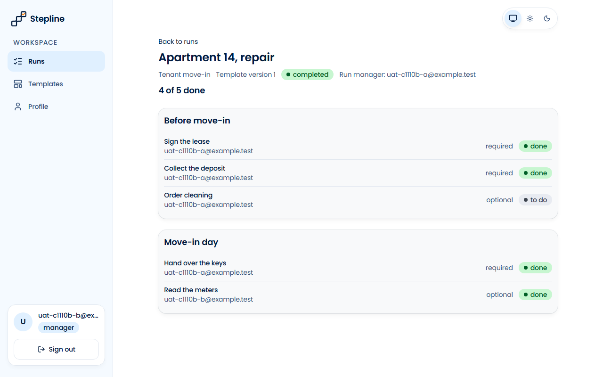

**Кроки:** ✔ Дано: a run with status "completed" that has the optional task "Order a part" with status "to do" — on prod the optional task 5 «Read the meters» — and the assignee of this task, manager B (uat-c1110b-b@example.test) → ✔ Коли: the assignee marks "Order a part" (task 5 «Read the meters») as done → ✔ Тоді: the task has status "done", the run stays "completed", and the progress counts the task as done

**Агент (claude-haiku-5-5, PASS):** На кадрі frame-then-1.png сторінка запуску «Apartment 14, repair» показує бейдж «completed», підсумок «4 of 5 done» і рядок «Read the meters» (optional, uat-c1110b-b@example.test) зі статусом «done». Кількість виконаних завдань (Sign the lease, Collect the deposit, Hand over the keys, Read the meters) збігається з лічильником 4 з 5. Частини про перезавантаження, БД та відсутність підтвердження кадрами не перевіряються.

**Цитати агента, звірені зі сторінкою (aria):**
- «Read the meters» — є на сторінці
- «done» — є на сторінці
- «completed» — є на сторінці
- «4 of 5 done» — є на сторінці

**Правило:** R6: перевірки, агент і цитати збігаються

**Відео:** `test-results/artifacts/task-completed-optional-AC-f7bcf-leted»-прогрес-рахує-задачу-chromium/video.webm` · **траса:** `test-results/artifacts/task-completed-optional-AC-f7bcf-leted»-прогрес-рахує-задачу-chromium/trace.zip` (не в git)

**Рішення PM:** ☐ приймаю · ☐ відхилення від вимог (issue «Відхилення від вимог: AC-TASK-19 — …») · @login: ____

## AC-VENDOR-01 — PASS

**Тест:** AC-VENDOR-01: менеджер A запускає «Tenant move-in» і призначає вендора V виконавцем задач 3 і 4 — у задач 1, 2 і 5 виконавець A

**Критерій** (requirements/39-assign-a-vendor-own-tasks.md):

> AC-VENDOR-01: Given manager A, vendor V and the template "Tenant move-in" with 5 tasks. When A launches the template for the case "Apartment 12, move-in" and assigns V as the assignee of tasks 3 and 4. Then tasks 3 and 4 have V as the assignee, and tasks 1, 2 and 5 have A.

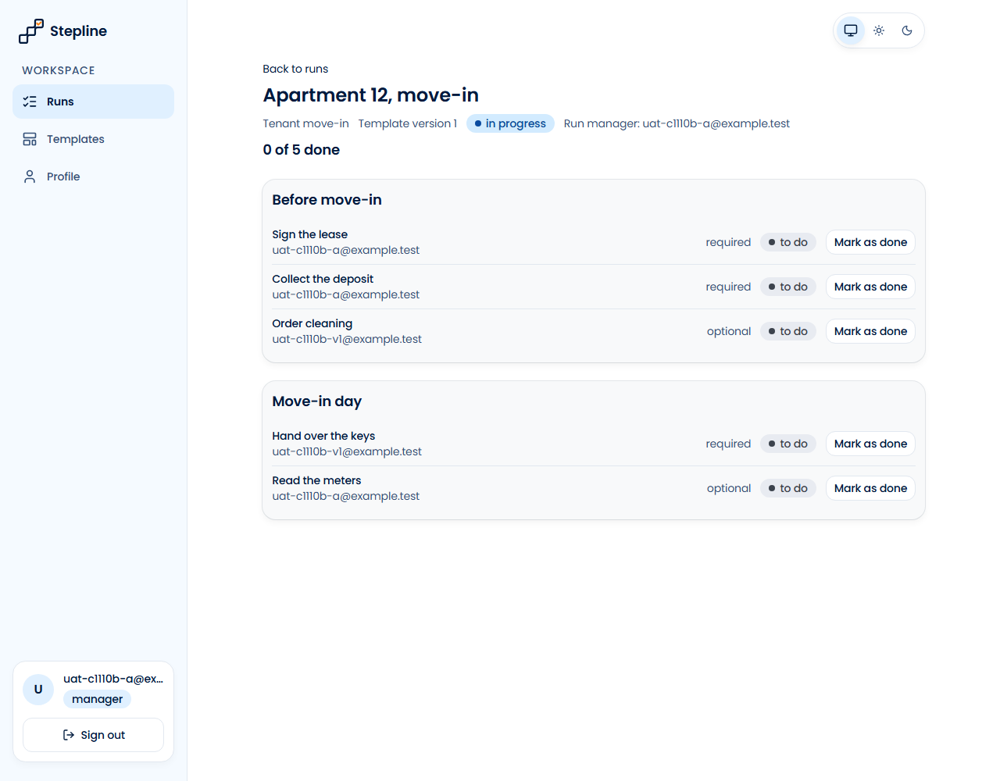

**Кроки:** ✔ Дано: manager A (uat-c1110b-a@example.test), vendor V (uat-c1110b-v1@example.test) and the template "Tenant move-in" with 5 tasks → ✔ Коли: A launches the template for the case "Apartment 12, move-in" and assigns V as the assignee of tasks 3 and 4 → ✔ Тоді: tasks 3 and 4 have V as the assignee, and tasks 1, 2 and 5 have A

**Агент (claude-haiku-5-5, PASS):** На кадрі frame-then-1.png видно сторінку запуску «Apartment 12, move-in» з п'ятьма завданнями в порядку шаблону. Біля «Order cleaning» (3) і «Hand over the keys» (4) стоїть uat-c1110b-v1@example.test, а біля «Sign the lease» (1), «Collect the deposit» (2) і «Read the meters» (5) — uat-c1110b-a@example.test; кадр читабельний, обрізання немає. Частини з розділу «Не з кадрів» не оцінювалися.

**Цитати агента, звірені зі сторінкою (aria):**
- «Order cleaning uat-c1110b-v1@example.test» — є на сторінці
- «Hand over the keys uat-c1110b-v1@example.test» — є на сторінці
- «Sign the lease uat-c1110b-a@example.test» — є на сторінці
- «Collect the deposit uat-c1110b-a@example.test» — є на сторінці
- «Read the meters uat-c1110b-a@example.test» — є на сторінці

**Правило:** R6: перевірки, агент і цитати збігаються

**Відео:** `test-results/artifacts/vendor-assign-at-launch-AC-087c3--задач-1-2-і-5-виконавець-A-chromium/video.webm` · **траса:** `test-results/artifacts/vendor-assign-at-launch-AC-087c3--задач-1-2-і-5-виконавець-A-chromium/trace.zip` (не в git)

**Рішення PM:** ☐ приймаю · ☐ відхилення від вимог (issue «Відхилення від вимог: AC-VENDOR-01 — …») · @login: ____

## AC-VENDOR-02 — PASS

**Тест:** AC-VENDOR-02: менеджер A відкриває вибір виконавця — email B, адміністратора й V, без імен, ролей і інших даних профілю

**Критерій** (requirements/39-assign-a-vendor-own-tasks.md):

> AC-VENDOR-02: Given managers A and B, an administrator and vendor V, and A launching a template. When A opens the assignee picker. Then A sees the emails of B, of the administrator and of V, and no names, roles or other profile data.

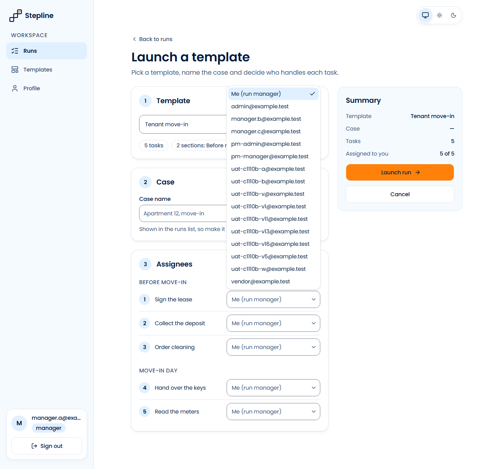

**Кроки:** ✔ Дано: managers A (manager.a@example.test) and B (manager.b@example.test), an administrator (admin@example.test) and vendor V (vendor@example.test), and A launching a template → ✔ Коли: A opens the assignee picker → ✔ Тоді: A sees the emails of B, of the administrator and of V, and no names, roles or other profile data

**Агент (claude-haiku-5-5, PASS):** На кадрі frame-then-1.png відкритий список виконавців на сторінці /runs/new, і в ньому видно email manager.b@example.test, admin@example.test та vendor@example.test. Усі три видимі частини «Тоді» підтверджено дослівними цитатами. Список містить також інші email (manager.c, pm-admin, uat-c1110b-…), але перевірка «без імен і ролей» належить автоматичним перевіркам, тому я її не оцінював.

**Цитати агента, звірені зі сторінкою (aria):**
- «manager.b@example.test» — є на сторінці
- «admin@example.test» — є на сторінці
- «vendor@example.test» — є на сторінці

**Правило:** R6: перевірки, агент і цитати збігаються

**Відео:** `test-results/artifacts/vendor-assignee-picker-AC--75754-ролей-і-інших-даних-профілю-chromium/video.webm` · **траса:** `test-results/artifacts/vendor-assignee-picker-AC--75754-ролей-і-інших-даних-профілю-chromium/trace.zip` (не в git)

**Рішення PM:** ☐ приймаю · ☐ відхилення від вимог (issue «Відхилення від вимог: AC-VENDOR-02 — …») · @login: ____

## AC-VENDOR-03 — PASS

**Тест:** AC-VENDOR-03: вендор V відкриває список запусків — лише «Apartment 12, move-in» зі статусом і «Your tasks: 0 of 2 done», без «Apartment 14, repair»

**Критерій** (requirements/39-assign-a-vendor-own-tasks.md):

> AC-VENDOR-03: Given vendor V who is the assignee of 2 tasks in the run "Apartment 12, move-in" and of no task in the run "Apartment 14, repair". When V opens the list of runs. Then V sees only the run "Apartment 12, move-in" with its run status and "Your tasks: 0 of 2 done", and does not see "Apartment 14, repair".

**Кроки:** ✔ Дано: vendor V (uat-c1110b-v@example.test) who is the assignee of 2 tasks in the run "Apartment 12, move-in" and of no task in the run "Apartment 14, repair" → ✔ Коли: V opens the list of runs → ✔ Тоді: V sees only the run "Apartment 12, move-in" with its run status and "Your tasks: 0 of 2 done", and does not see "Apartment 14, repair"

**Агент (claude-haiku-5-5, PASS):** На кадрі сторінка «Runs» з одним рядком: «Apartment 12, move-in», статус «in progress» і «Your tasks: 0 of 2 done». Вкладка «All» показує лічильник 1, «Completed» — 0. Текст збігається посимвольно. Відсутність «Apartment 14, repair» на сторінці — за межами кадрів у цій оцінці і не оцінюється.

**Цитати агента, звірені зі сторінкою (aria):**
- «Apartment 12, move-in» — є на сторінці
- «in progress» — є на сторінці
- «Your tasks: 0 of 2 done» — є на сторінці

**Правило:** R6: перевірки, агент і цитати збігаються

**Відео:** `test-results/artifacts/vendor-runs-list-AC-VENDOR-1f3da-»-без-«Apartment-14-repair»-chromium/video.webm` · **траса:** `test-results/artifacts/vendor-runs-list-AC-VENDOR-1f3da-»-без-«Apartment-14-repair»-chromium/trace.zip` (не в git)

**Рішення PM:** ☐ приймаю · ☐ відхилення від вимог (issue «Відхилення від вимог: AC-VENDOR-03 — …») · @login: ____

## AC-VENDOR-04 — PASS

**Тест:** AC-VENDOR-04: вендор V відкриває «Apartment 12, move-in» — рівно задачі 3 і 4 з назвою, секцією, позначкою й статусом, без задач 1, 2, 5, чужих email і прогресу запуску

**Критерій** (requirements/39-assign-a-vendor-own-tasks.md):

> AC-VENDOR-04: Given vendor V who is the assignee of tasks 3 and 4 in the run "Apartment 12, move-in" (5 tasks). When V opens this run. Then V sees exactly tasks 3 and 4, each with its name, its section, the mark "required" or "optional" and its status, and does not see tasks 1, 2 and 5, the emails of other users or the progress of the whole run.

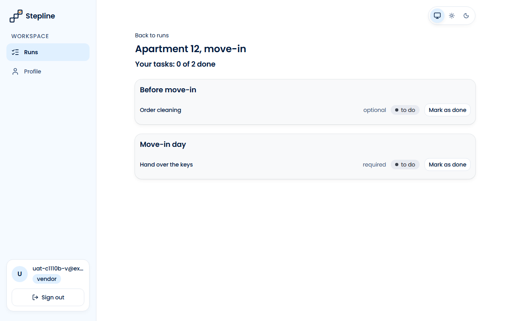

**Кроки:** ✔ Дано: vendor V (uat-c1110b-v@example.test) who is the assignee of tasks 3 and 4 in the run "Apartment 12, move-in" (5 tasks) → ✔ Коли: V opens this run → ✔ Тоді: V sees exactly tasks 3 and 4, each with its name, its section, the mark "required" or "optional" and its status, and does not see tasks 1, 2 and 5, the emails of other users or the progress of the whole run

**Агент (claude-haiku-5-5, PASS):** На кадрі видно сторінку «Apartment 12, move-in» з двома завданнями: «Order cleaning» у секції «Before move-in» (optional, to do) і «Hand over the keys» у секції «Move-in day» (required, to do). Текст читається чітко, кадр не обрізаний. Частини «Не з кадрів» (кількість завдань, відсутність завдань 1, 2, 5, чужих email, прогресу всього запуску) не оцінювалися.

**Цитати агента, звірені зі сторінкою (aria):**
- «Before move-in» — є на сторінці
- «Order cleaning» — є на сторінці
- «optional» — є на сторінці
- «to do» — є на сторінці
- «Move-in day» — є на сторінці
- «Hand over the keys» — є на сторінці
- «required» — є на сторінці
- «to do» — є на сторінці

**Правило:** R6: перевірки, агент і цитати збігаються

**Відео:** `test-results/artifacts/vendor-run-page-AC-VENDOR--47f1a-их-email-і-прогресу-запуску-chromium/video.webm` · **траса:** `test-results/artifacts/vendor-run-page-AC-VENDOR--47f1a-их-email-і-прогресу-запуску-chromium/trace.zip` (не в git)

**Рішення PM:** ☐ приймаю · ☐ відхилення від вимог (issue «Відхилення від вимог: AC-VENDOR-04 — …») · @login: ____

## AC-VENDOR-05 — PASS

**Тест:** AC-VENDOR-05: вендор V позначає задачу 3 (не останню обов'язкову) виконаною — «done» і «Your tasks: 1 of 2 done»

**Критерій** (requirements/39-assign-a-vendor-own-tasks.md):

> AC-VENDOR-05: Given vendor V who is the assignee of task 3 with status "to do", which is not the last required task of the run "Apartment 12, move-in". When V marks task 3 as done. Then task 3 has status "done", and V sees "Your tasks: 1 of 2 done".

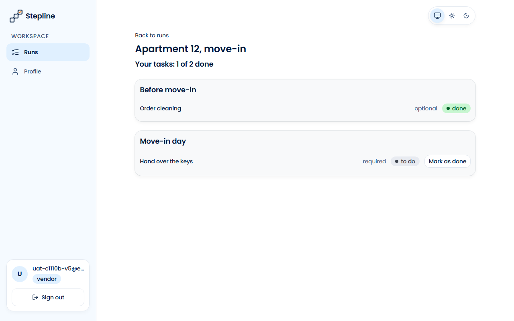

**Кроки:** ✔ Дано: vendor V (uat-c1110b-v5@example.test) who is the assignee of task 3 with status "to do", which is not the last required task of the run "Apartment 12, move-in" → ✔ Коли: V marks task 3 as done → ✔ Тоді: task 3 has status "done", and V sees "Your tasks: 1 of 2 done"

**Агент (claude-haiku-5-5, PASS):** На кадрі в картці «Before move-in» видно завдання «Order cleaning» зі статусом «done» (зелений бейдж). Заголовок сторінки над картками читається як «Your tasks: 1 of 2 done». Кадр чіткий, не обрізаний; на ньому немає блоку «Move-in day» з іншим завданням у статусі done, тож підтверджено лише видимі частини «Тоді».

**Цитати агента, звірені зі сторінкою (aria):**
- «Order cleaning» — є на сторінці
- «done» — є на сторінці
- «Your tasks: 1 of 2 done» — є на сторінці

**Правило:** R6: перевірки, агент і цитати збігаються

**Відео:** `test-results/artifacts/vendor-mark-done-AC-VENDOR-fbef7--і-«Your-tasks-1-of-2-done»-chromium/video.webm` · **траса:** `test-results/artifacts/vendor-mark-done-AC-VENDOR-fbef7--і-«Your-tasks-1-of-2-done»-chromium/trace.zip` (не в git)

**Рішення PM:** ☐ приймаю · ☐ відхилення від вимог (issue «Відхилення від вимог: AC-VENDOR-05 — …») · @login: ____

## AC-VENDOR-06 — PASS

**Тест:** AC-VENDOR-06: вендор V відкриває «Apartment 14, repair» за прямим посиланням — «Run not found», жодної задачі запуску

**Критерій** (requirements/39-assign-a-vendor-own-tasks.md):

> AC-VENDOR-06: Given the run "Apartment 14, repair" in which vendor V has no task. When V opens the page of this run by a direct link. Then V sees the message "Run not found" and none of the tasks of the run.

**Кроки:** ✔ Дано: the run "Apartment 14, repair" in which vendor V (uat-c1110b-v@example.test) has no task → ✔ Коли: V opens the page of this run by a direct link → ✔ Тоді: V sees the message "Run not found" and none of the tasks of the run

**Агент (claude-haiku-5-5, PASS):** На кадрі frame-then-1.png у сторінці, де вхід виконано як vendor (uat-c1110b-v@ex…), великим заголовком видно «Run not found», під посиланням «Back to runs». Завдань, назв завдань і назви кейсу «Apartment 14, repair» на кадрі не видно; ці частини не оцінювалися, бо вони з розділу «Не з кадрів».

**Цитати агента, звірені зі сторінкою (aria):**
- «Run not found» — є на сторінці

**Правило:** R6: перевірки, агент і цитати збігаються

**Відео:** `test-results/artifacts/vendor-foreign-run-AC-VEND-37f1f-ound»-жодної-задачі-запуску-chromium/video.webm` · **траса:** `test-results/artifacts/vendor-foreign-run-AC-VEND-37f1f-ound»-жодної-задачі-запуску-chromium/trace.zip` (не в git)

**Рішення PM:** ☐ приймаю · ☐ відхилення від вимог (issue «Відхилення від вимог: AC-VENDOR-06 — …») · @login: ____

## AC-VENDOR-07 — PASS

**Тест:** AC-VENDOR-07: вендор V напряму позначає виконаною задачу 1 менеджера A — задача 1 лишається «to do», відповідь — повідомлення AC-TASK-03

**Критерій** (requirements/39-assign-a-vendor-own-tasks.md):

> AC-VENDOR-07: Given the run "Apartment 12, move-in" in which task 1 is assigned to manager A and tasks 3 and 4 to vendor V. When V tries to mark task 1 as done directly, bypassing the pages of the application. Then task 1 stays "to do", and V gets the message "Only the task's assignee, the run manager, or an administrator can mark a task as done".

**Кроки:** ✔ Дано: the run "Apartment 12, move-in" in which task 1 is assigned to manager A (uat-c1110b-a@example.test) and tasks 3 and 4 to vendor V (uat-c1110b-v@example.test) → ✔ Коли: V tries to mark task 1 as done directly, bypassing the pages of the application → ✔ Тоді: task 1 stays "to do", and V gets the message "Only the task's assignee, the run manager, or an administrator can mark a task as done"

**Агент (claude-haiku-5-5, PASS):** На кадрі frame-then-1.png видно сторінку запуску «Apartment 12, move-in» (сесія менеджера A, uat-c1110b-a@example.test). Біля завдання «Sign the lease» стоїть статус «to do», і завдання не позначено як виконане (0 of 5 done). Повідомлення про відмову V на кадрі відсутнє, але воно віднесене до «Не з кадрів», тому я його не оцінюю.

**Цитати агента, звірені зі сторінкою (aria):**
- «Apartment 12, move-in» — є на сторінці
- «Sign the lease» — є на сторінці
- «to do» — є на сторінці

**Правило:** R6: перевірки, агент і цитати збігаються

**Відео:** `test-results/artifacts/vendor-foreign-task-direct-ad267-ь-—-повідомлення-AC-TASK-03-chromium/video.webm` · **траса:** `test-results/artifacts/vendor-foreign-task-direct-ad267-ь-—-повідомлення-AC-TASK-03-chromium/trace.zip` (не в git)

**Рішення PM:** ☐ приймаю · ☐ відхилення від вимог (issue «Відхилення від вимог: AC-VENDOR-07 — …») · @login: ____

## AC-VENDOR-08 — PASS

**Тест:** AC-VENDOR-08: вендор V відкриває список шаблонів за прямим посиланням — «Not enough rights» і «Back to runs», жодного шаблону

**Критерій** (requirements/39-assign-a-vendor-own-tasks.md):

> AC-VENDOR-08: Given vendor V signed in. When V opens the list of templates by a direct link. Then V sees the message "Not enough rights" and the link "Back to runs", and no template.

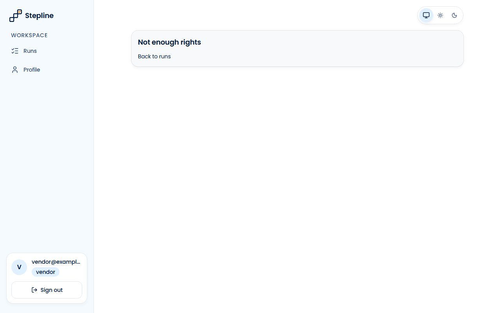

**Кроки:** ✔ Дано: vendor V (vendor@example.test) signed in → ✔ Коли: V opens the list of templates by a direct link → ✔ Тоді: V sees the message "Not enough rights" and the link "Back to runs", and no template

**Агент (claude-haiku-5-5, PASS):** На кадрі frame-then-1.png видно картку з написом «Not enough rights» і посиланням «Back to runs» під ним. Таблиці шаблонів на кадрі немає, у бічному меню активний пункт «Runs», а внизу показано vendor@example… з роллю vendor. Адресний рядок не видно, тому сам маршрут /templates і адресу посилання з кадру не перевірено.

**Цитати агента, звірені зі сторінкою (aria):**
- «Not enough rights» — є на сторінці
- «Back to runs» — є на сторінці

**Правило:** R6: перевірки, агент і цитати збігаються

**Відео:** `test-results/artifacts/vendor-templates-forbidden-42556-ck-to-runs»-жодного-шаблону-chromium/video.webm` · **траса:** `test-results/artifacts/vendor-templates-forbidden-42556-ck-to-runs»-жодного-шаблону-chromium/trace.zip` (не в git)

**Рішення PM:** ☐ приймаю · ☐ відхилення від вимог (issue «Відхилення від вимог: AC-VENDOR-08 — …») · @login: ____

## AC-VENDOR-09 — PASS

**Тест:** AC-VENDOR-09: вендор V напряму запускає «Tenant move-in» — запуску не створено, список запусків не змінився

**Критерій** (requirements/39-assign-a-vendor-own-tasks.md):

> AC-VENDOR-09: Given vendor V signed in and the template "Tenant move-in" with current version 1. When V tries to launch this template directly, bypassing the pages of the application. Then no run is created, and the list of runs does not change.

**Кроки:** ✔ Дано: vendor V (uat-c1110b-v@example.test) signed in and the template "Tenant move-in" with current version 1 → ✔ Коли: V tries to launch this template directly, bypassing the pages of the application → ✔ Тоді: no run is created, and the list of runs does not change

**Агент (claude-haiku-5-5, PASS):** На кадрі сторінки /runs видно один рядок у списку з текстом «Apartment 12, move-in» і «Your tasks: 0 of 2 done»; лічильник вкладки «All» показує 1, тож список справді містить лише цей запуск. Частини про HTTP 403, відсутність запуску в базі та перезавантаження списку не з кадрів і не оцінювалися.

**Цитати агента, звірені зі сторінкою (aria):**
- «Apartment 12, move-in» — є на сторінці
- «Your tasks: 0 of 2 done» — є на сторінці

**Правило:** R6: перевірки, агент і цитати збігаються

**Відео:** `test-results/artifacts/vendor-launch-direct-AC-VE-ca5d1-список-запусків-не-змінився-chromium/video.webm` · **траса:** `test-results/artifacts/vendor-launch-direct-AC-VE-ca5d1-список-запусків-не-змінився-chromium/trace.zip` (не в git)

**Рішення PM:** ☐ приймаю · ☐ відхилення від вимог (issue «Відхилення від вимог: AC-VENDOR-09 — …») · @login: ____

## AC-VENDOR-10 — PASS

**Тест:** AC-VENDOR-10: вендор без задач відкриває список запусків — «No tasks assigned to you yet.», без порожньої таблиці

**Критерій** (requirements/39-assign-a-vendor-own-tasks.md):

> AC-VENDOR-10: Given vendor V to whom no task is assigned. When V opens the list of runs. Then V sees the message "No tasks assigned to you yet." and no empty table.

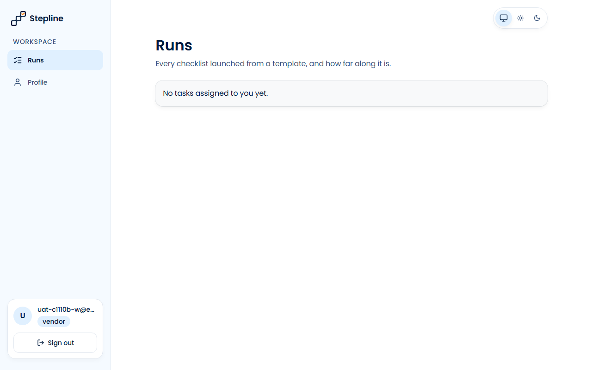

**Кроки:** ✔ Дано: vendor V (uat-c1110b-w@example.test) to whom no task is assigned → ✔ Коли: V opens the list of runs → ✔ Тоді: V sees the message "No tasks assigned to you yet." and no empty table

**Агент (claude-haiku-5-5, PASS):** На кадрі сторінки Runs під заголовком видно сірий блок із текстом «No tasks assigned to you yet.», який посимвольно збігається з критерієм. Таблиці та заголовків колонок на кадрі немає; це «не з кадрів», тому не оцінювалось. Кадр читабельний і повний, без завантаження.

**Цитати агента, звірені зі сторінкою (aria):**
- «No tasks assigned to you yet.» — є на сторінці

**Правило:** R6: перевірки, агент і цитати збігаються

**Відео:** `test-results/artifacts/vendor-runs-empty-AC-VENDO-198f8-yet-»-без-порожньої-таблиці-chromium/video.webm` · **траса:** `test-results/artifacts/vendor-runs-empty-AC-VENDO-198f8-yet-»-без-порожньої-таблиці-chromium/trace.zip` (не в git)

**Рішення PM:** ☐ приймаю · ☐ відхилення від вимог (issue «Відхилення від вимог: AC-VENDOR-10 — …») · @login: ____

## AC-VENDOR-11 — PASS

**Тест:** AC-VENDOR-11: вендор V відкриває «Apartment 12, move-in» — заголовок з назвою випадку й «Your tasks: 1 of 2 done», без статусу запуску, назви й версії шаблону

**Критерій** (requirements/39-assign-a-vendor-own-tasks.md):

> AC-VENDOR-11: Given vendor V who is the assignee of tasks 3 ("done") and 4 ("to do") in the run "Apartment 12, move-in" (5 tasks). When V opens this run. Then V sees the case name "Apartment 12, move-in" as the title of the page and "Your tasks: 1 of 2 done", and does not see the run status, the template name or the template version.

**Кроки:** ✔ Дано: vendor V (uat-c1110b-v11@example.test) who is the assignee of tasks 3 ("done") and 4 ("to do") in the run "Apartment 12, move-in" (5 tasks) → ✔ Коли: V opens this run → ✔ Тоді: V sees the case name "Apartment 12, move-in" as the title of the page and "Your tasks: 1 of 2 done", and does not see the run status, the template name or the template version

**Агент (claude-haiku-5-5, PASS):** На кадрі frame-then-1.png заголовок сторінки «Apartment 12, move-in» і підзаголовок «Your tasks: 1 of 2 done» збігаються з критерієм посимвольно. Видимі частини «Тоді» виконано. Відсутність статусу прогону та назви шаблону/версії перевіряють автоматичні перевірки, тому тут їх не оцінювано.

**Цитати агента, звірені зі сторінкою (aria):**
- «Apartment 12, move-in» — є на сторінці
- «Your tasks: 1 of 2 done» — є на сторінці

**Правило:** R6: перевірки, агент і цитати збігаються

**Відео:** `test-results/artifacts/vendor-run-title-AC-VENDOR-8f957-уску-назви-й-версії-шаблону-chromium/video.webm` · **траса:** `test-results/artifacts/vendor-run-title-AC-VENDOR-8f957-уску-назви-й-версії-шаблону-chromium/trace.zip` (не в git)

**Рішення PM:** ☐ приймаю · ☐ відхилення від вимог (issue «Відхилення від вимог: AC-VENDOR-11 — …») · @login: ____

## AC-VENDOR-12 — PASS

**Тест:** AC-VENDOR-12: вендор V відкриває список запусків — рядок «Apartment 12, move-in» з випадком, статусом і «Your tasks: 0 of 2 done», без назви шаблону «Tenant move-in»

**Критерій** (requirements/39-assign-a-vendor-own-tasks.md):

> AC-VENDOR-12: Given vendor V who is the assignee of 2 tasks in the run "Apartment 12, move-in", launched from the template "Tenant move-in". When V opens the list of runs. Then the row of this run shows the case name, the run status and "Your tasks: 0 of 2 done", and does not show the template name "Tenant move-in".

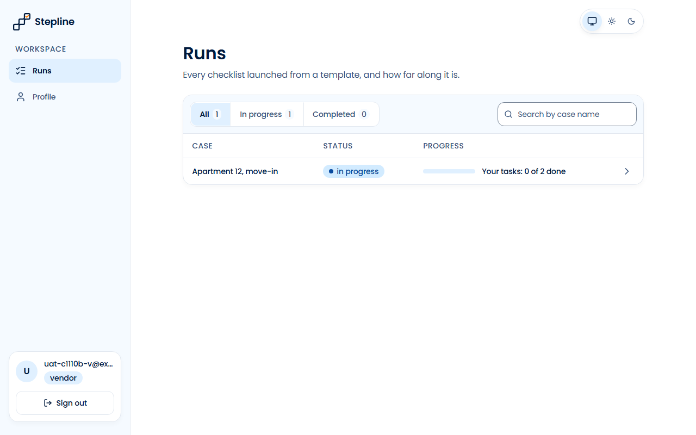

**Кроки:** ✔ Дано: vendor V (uat-c1110b-v@example.test) who is the assignee of 2 tasks in the run "Apartment 12, move-in", launched from the template "Tenant move-in" → ✔ Коли: V opens the list of runs → ✔ Тоді: the row of this run shows the case name, the run status and "Your tasks: 0 of 2 done", and does not show the template name "Tenant move-in"

**Агент (claude-haiku-5-5, PASS):** На кадрі /runs видно один рядок із написом «Apartment 12, move-in», статусом «in progress» і прогресом «Your tasks: 0 of 2 done»; усі три видимі частини «Тоді» збігаються посимвольно з критерієм. Назви шаблону «Tenant move-in» на кадрі не видно, але вимога про відсутність шаблону на сторінці не оцінюється з кадрів і перевіряється автоматично.

**Цитати агента, звірені зі сторінкою (aria):**
- «Apartment 12, move-in» — є на сторінці
- «in progress» — є на сторінці
- «Your tasks: 0 of 2 done» — є на сторінці

**Правило:** R6: перевірки, агент і цитати збігаються

**Відео:** `test-results/artifacts/vendor-runs-row-AC-VENDOR--e59ef-ви-шаблону-«Tenant-move-in»-chromium/video.webm` · **траса:** `test-results/artifacts/vendor-runs-row-AC-VENDOR--e59ef-ви-шаблону-«Tenant-move-in»-chromium/trace.zip` (не в git)

**Рішення PM:** ☐ приймаю · ☐ відхилення від вимог (issue «Відхилення від вимог: AC-VENDOR-12 — …») · @login: ____

## AC-VENDOR-13 — PASS

**Тест:** AC-VENDOR-13: вендор V входить — список запусків, навігація лише «Runs» і «Profile»

**Критерій** (requirements/39-assign-a-vendor-own-tasks.md):

> AC-VENDOR-13: Given vendor V who is the assignee of 2 tasks in the run "Apartment 12, move-in". When V signs in. Then V sees the list of runs, and the navigation shows only "Runs" and "Profile".

**Кроки:** ✔ Дано: vendor V (uat-c1110b-v13@example.test) who is the assignee of 2 tasks in the run "Apartment 12, move-in" → ✔ Коли: V signs in → ✔ Тоді: V sees the list of runs, and the navigation shows only "Runs" and "Profile"

**Агент (claude-haiku-5-5, PASS):** На кадрі видно сторінку «Runs» зі списком із одного рядка «Apartment 12, move-in» (статус in progress, «Your tasks: 0 of 2 done»). У лівій навігації (WORKSPACE) є рівно два пункти: «Runs» і «Profile»; пункту «Templates» немає. Кадр чіткий, не обрізаний.

**Цитати агента, звірені зі сторінкою (aria):**
- «Runs» — є на сторінці
- «Apartment 12, move-in» — є на сторінці
- «Runs» — є на сторінці
- «Profile» — є на сторінці

**Правило:** R6: перевірки, агент і цитати збігаються

**Відео:** `test-results/artifacts/vendor-sign-in-AC-VENDOR-1-89aff-ція-лише-«Runs»-і-«Profile»-chromium/video.webm` · **траса:** `test-results/artifacts/vendor-sign-in-AC-VENDOR-1-89aff-ція-лише-«Runs»-і-«Profile»-chromium/trace.zip` (не в git)

**Рішення PM:** ☐ приймаю · ☐ відхилення від вимог (issue «Відхилення від вимог: AC-VENDOR-13 — …») · @login: ____

## AC-VENDOR-14 — PASS

**Тест:** AC-VENDOR-14: вендор V відкриває форму запуску, сторінку шаблону, список версій і редактор за прямим посиланням — «Not enough rights» і «Back to runs», без вмісту шаблону

**Критерій** (requirements/39-assign-a-vendor-own-tasks.md):

> AC-VENDOR-14: Given vendor V signed in. When V opens the launch form, the page of a template, the list of versions or the editor by a direct link. Then V sees the message "Not enough rights" and the link "Back to runs", and no content of the template.

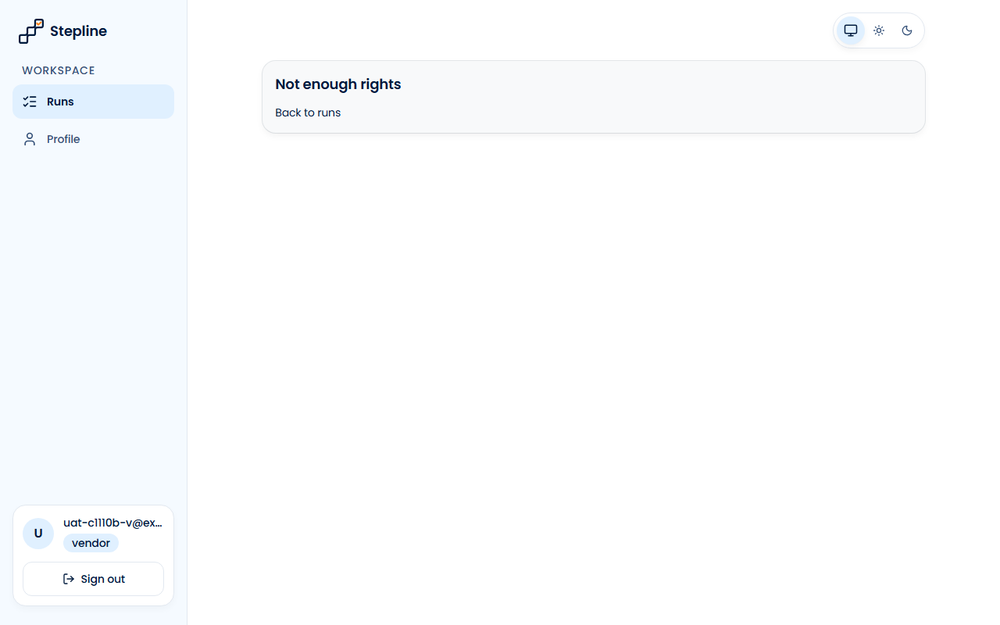

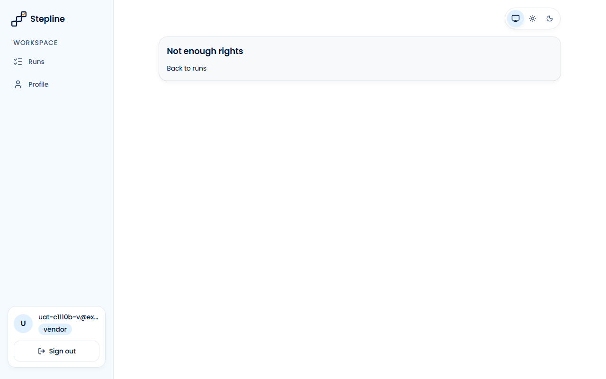

**Кроки:** ✔ Дано: vendor V (uat-c1110b-v@example.test) signed in → ✔ Коли: V opens the launch form by a direct link → ✔ Тоді: V sees the message "Not enough rights" and the link "Back to runs", and no content of the template → ✔ Коли: V opens the page of a template by a direct link → ✔ Тоді: V sees the message "Not enough rights" and the link "Back to runs", and no content of the template → ✔ Коли: V opens the list of versions by a direct link → ✔ Тоді: V sees the message "Not enough rights" and the link "Back to runs", and no content of the template → ✔ Коли: V opens the editor by a direct link → ✔ Тоді: V sees the message "Not enough rights" and the link "Back to runs", and no content of the template

**Агент (claude-haiku-5-5, PASS):** На всіх чотирьох кадрах (launch form, сторінка шаблону, список версій, редактор) видно однаковий блок із написом «Not enough rights» і посиланням «Back to runs», у сайдбарі показано користувача vendor. Жодного вмісту шаблону («Tenant move-in» або його секцій) на кадрах немає. Адресний рядок на кадрах не видно, тому URL-частини критерію не оцінювалися.

**Цитати агента, звірені зі сторінкою (aria):**
- «Not enough rights» — є на сторінці
- «Back to runs» — є на сторінці
- «Not enough rights» — є на сторінці
- «Back to runs» — є на сторінці
- «Not enough rights» — є на сторінці
- «Back to runs» — є на сторінці
- «Not enough rights» — є на сторінці
- «Back to runs» — є на сторінці

**Правило:** R6: перевірки, агент і цитати збігаються

**Відео:** `test-results/artifacts/vendor-template-pages-forb-db293-to-runs»-без-вмісту-шаблону-chromium/video.webm` · **траса:** `test-results/artifacts/vendor-template-pages-forb-db293-to-runs»-без-вмісту-шаблону-chromium/trace.zip` (не в git)

**Рішення PM:** ☐ приймаю · ☐ відхилення від вимог (issue «Відхилення від вимог: AC-VENDOR-14 — …») · @login: ____

## AC-VENDOR-15 — PASS

**Тест:** AC-VENDOR-15: вендор V напряму позначає задачу 1 «Apartment 14, repair», де не має задач, — задача 1 лишається «to do», відповідь «Run not found»

**Критерій** (requirements/39-assign-a-vendor-own-tasks.md):

> AC-VENDOR-15: Given the run "Apartment 14, repair" in which vendor V has no task and task 1 is assigned to manager A. When V tries to mark task 1 as done directly, bypassing the pages of the application. Then task 1 stays "to do", and V gets the message "Run not found".

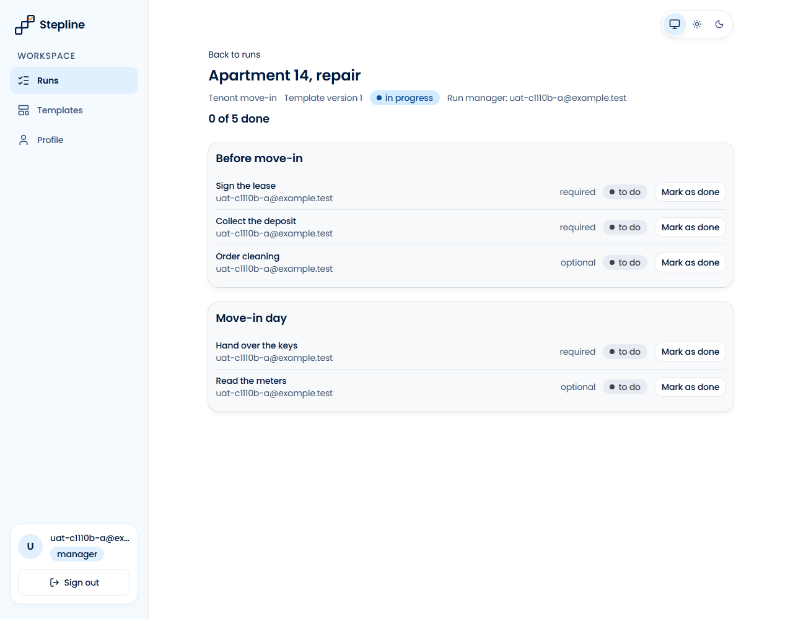

**Кроки:** ✔ Дано: the run "Apartment 14, repair" in which vendor V (uat-c1110b-v@example.test) has no task and task 1 is assigned to manager A (uat-c1110b-a@example.test) → ✔ Коли: V tries to mark task 1 as done directly, bypassing the pages of the application → ✔ Тоді: task 1 stays "to do", and V gets the message "Run not found"

**Агент (claude-haiku-5-5, PASS):** На кадрі видно сторінку run «Apartment 14, repair» із «Run manager: uat-c1110b-a@example.test»: перший пункт «Sign the lease» (required) має статус «to do», а лічильник показує «0 of 5 done». Кадр зроблений у сесії менеджера A, а не V; це відповідає видимій частині «Тоді». Повідомлення «Run not found» та стан БД у кадрі не видно, тому ці частини не оцінено.

**Цитати агента, звірені зі сторінкою (aria):**
- «Apartment 14, repair» — є на сторінці
- «Run manager: uat-c1110b-a@example.test» — є на сторінці
- «Sign the lease» — є на сторінці
- «to do» — є на сторінці

**Правило:** R6: перевірки, агент і цитати збігаються

**Відео:** `test-results/artifacts/vendor-foreign-run-task-di-54dad-»-відповідь-«Run-not-found»-chromium/video.webm` · **траса:** `test-results/artifacts/vendor-foreign-run-task-di-54dad-»-відповідь-«Run-not-found»-chromium/trace.zip` (не в git)

**Рішення PM:** ☐ приймаю · ☐ відхилення від вимог (issue «Відхилення від вимог: AC-VENDOR-15 — …») · @login: ____

## AC-VENDOR-16 — PASS

**Тест:** AC-VENDOR-16: вендор V позначає необов'язкову задачу 3 запуску «completed» — «done», «Your tasks: 1 of 1 done», запуск лишається «completed»

**Критерій** (requirements/39-assign-a-vendor-own-tasks.md):

> AC-VENDOR-16: Given the run "Apartment 12, move-in" with status "completed" in which vendor V is the assignee of the optional task 3 with status "to do". When V marks task 3 as done. Then task 3 has status "done", V sees "Your tasks: 1 of 1 done", and the run stays "completed".

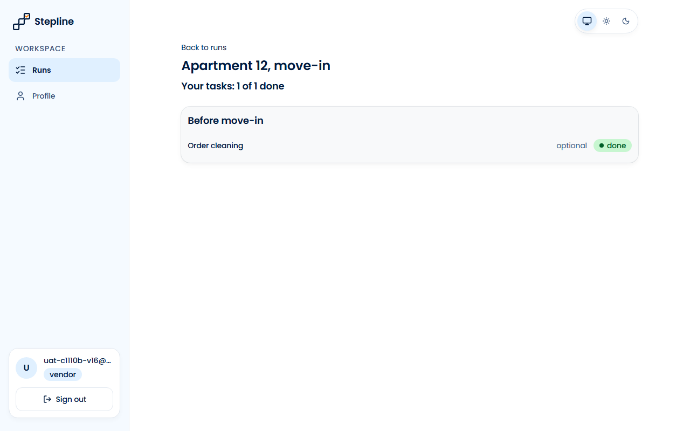
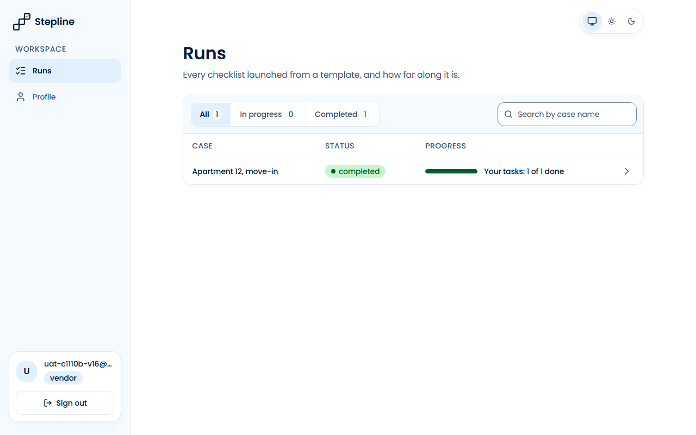

**Кроки:** ✔ Дано: the run "Apartment 12, move-in" with status "completed" in which vendor V (uat-c1110b-v16@example.test) is the assignee of the optional task 3 with status "to do" → ✔ Коли: V marks task 3 as done → ✔ Тоді: task 3 has status "done", V sees "Your tasks: 1 of 1 done" → ✔ Тоді: the run stays "completed"

**Агент (claude-haiku-5-5, PASS):** На frame-then-1 видно завдання «Order cleaning» зі статусом «done» і підсумок «Your tasks: 1 of 1 done» на сторінці run «Apartment 12, move-in». На frame-then-2 у списку /runs рядок «Apartment 12, move-in» має статус «completed» і той самий напис «Your tasks: 1 of 1 done». Усі видимі частини «Тоді» підтверджені; частини з розділу «Не з кадрів» не оцінювалися.

**Цитати агента, звірені зі сторінкою (aria):**
- «Order cleaning» — є на сторінці
- «done» — є на сторінці
- «Your tasks: 1 of 1 done» — є на сторінці
- «Apartment 12, move-in» — є на сторінці
- «completed» — є на сторінці
- «Your tasks: 1 of 1 done» — є на сторінці

**Правило:** R6: перевірки, агент і цитати збігаються

**Відео:** `test-results/artifacts/vendor-completed-optional--8c6cc-апуск-лишається-«completed»-chromium/video.webm` · **траса:** `test-results/artifacts/vendor-completed-optional--8c6cc-апуск-лишається-«completed»-chromium/trace.zip` (не в git)

**Рішення PM:** ☐ приймаю · ☐ відхилення від вимог (issue «Відхилення від вимог: AC-VENDOR-16 — …») · @login: ____

## AC-VENDOR-17 — PASS

**Тест:** AC-VENDOR-17: вендор V напряму запитує задачі «Apartment 12, move-in» — отримує лише задачі 3 і 4

**Критерій** (requirements/39-assign-a-vendor-own-tasks.md):

> AC-VENDOR-17: Given vendor V who is the assignee of tasks 3 and 4 in the run "Apartment 12, move-in" (5 tasks). When V requests the tasks of this run directly, bypassing the pages of the application. Then V receives only tasks 3 and 4.

**Кроки:** ✔ Дано: vendor V (uat-c1110b-v@example.test) who is the assignee of tasks 3 and 4 in the run "Apartment 12, move-in" (5 tasks) → ✔ Коли: V requests the tasks of this run directly, bypassing the pages of the application → ✔ Тоді: V receives only tasks 3 and 4

**Агент (claude-haiku-5-5, PASS):** На кадрі frame-then-1.png видно сторінку run «Apartment 12, move-in» з лічильником «Your tasks: 0 of 2 done» і рівно двома завданнями: «Order cleaning» (optional) та «Hand over the keys» (required). У лівій панелі видно обліковий запис «uat-c1110b-v@ex…» з роллю vendor, що відповідає V (email обрізаний, але ідентичність читається). Кадр показує сторінку застосунку, а не прямий запит до Data API, тому пряму частину перевірки кадри не покривають.

**Цитати агента, звірені зі сторінкою (aria):**
- «Apartment 12, move-in» — є на сторінці
- «Your tasks: 0 of 2 done» — є на сторінці
- «Order cleaning» — є на сторінці
- «Hand over the keys» — є на сторінці

**Правило:** R6: перевірки, агент і цитати збігаються

**Відео:** `test-results/artifacts/vendor-direct-own-tasks-AC-4fd63-—-отримує-лише-задачі-3-і-4-chromium/video.webm` · **траса:** `test-results/artifacts/vendor-direct-own-tasks-AC-4fd63-—-отримує-лише-задачі-3-і-4-chromium/trace.zip` (не в git)

**Рішення PM:** ☐ приймаю · ☐ відхилення від вимог (issue «Відхилення від вимог: AC-VENDOR-17 — …») · @login: ____

## AC-VENDOR-18 — PASS

**Тест:** AC-VENDOR-18: вендор V напряму запитує email і профілі інших і задачі «Apartment 14, repair» — нічого про інших і про цей запуск

**Критерій** (requirements/39-assign-a-vendor-own-tasks.md):

> AC-VENDOR-18: Given vendor V who is the assignee of tasks 3 and 4 in the run "Apartment 12, move-in" and of no task in the run "Apartment 14, repair". When V requests directly, bypassing the pages of the application, the emails and profiles of other users and the tasks of "Apartment 14, repair". Then V receives nothing about other users or about "Apartment 14, repair".

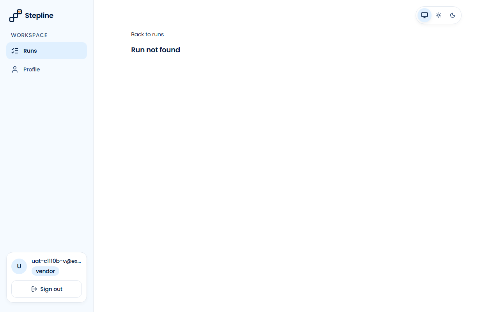

**Кроки:** ✔ Дано: vendor V (uat-c1110b-v@example.test) who is the assignee of tasks 3 and 4 in the run "Apartment 12, move-in" and of no task in the run "Apartment 14, repair" → ✔ Коли: V requests directly, bypassing the pages of the application, the emails and profiles of other users and the tasks of "Apartment 14, repair" → ✔ Тоді: V receives nothing about other users or about "Apartment 14, repair"

**Агент (claude-sonnet-5-5, PASS):** На кадрі сторінка запуску показує заголовок «Run not found» і жодного завдання. Користувач — vendor (uat-c1110b-v@ex…). Частини «Не з кадрів» не оцінювалися.

Haiku сказав NEEDS-HUMAN, тож розбір повторив Sonnet; рішення агента — за Sonnet.

**Цитати агента, звірені зі сторінкою (aria):**
- «Run not found» — є на сторінці

**Правило:** R6: перевірки, агент і цитати збігаються

**Відео:** `test-results/artifacts/vendor-direct-foreign-data-0c929--про-інших-і-про-цей-запуск-chromium/video.webm` · **траса:** `test-results/artifacts/vendor-direct-foreign-data-0c929--про-інших-і-про-цей-запуск-chromium/trace.zip` (не в git)

**Рішення PM:** ☐ приймаю · ☐ відхилення від вимог (issue «Відхилення від вимог: AC-VENDOR-18 — …») · @login: ____

## Як читати підсумок

- **PASS** — автоматичні перевірки пройшли, агент-рецензент погодився з кадром, а кожну його цитату знайдено на сторінці.
- **FAIL** — впала автоматична перевірка. Агент цього не перекриває: невидимі вади (буфер обміну, база) він на кадрі не побачить.
- **NEEDS-HUMAN** — перевірки зелені, але агент не погодився або його цитати немає на сторінці. Часто це слабкий тест або розбіжність між текстом AC і тестом — питання до PM, а не обов'язково вада продукту.

Правила: R1: перевірка впала — FAIL завжди, агент не перекриває; R2: немає вердикту агента або кадру; R3: перевірки пройшли, агент не погоджується — вирішує людина; R4: цитати агента немає на сторінці (aria) — не підтверджено; R5: помилка сторінки або 5xx під час сценарію; R6: перевірки, агент і цитати збігаються.
