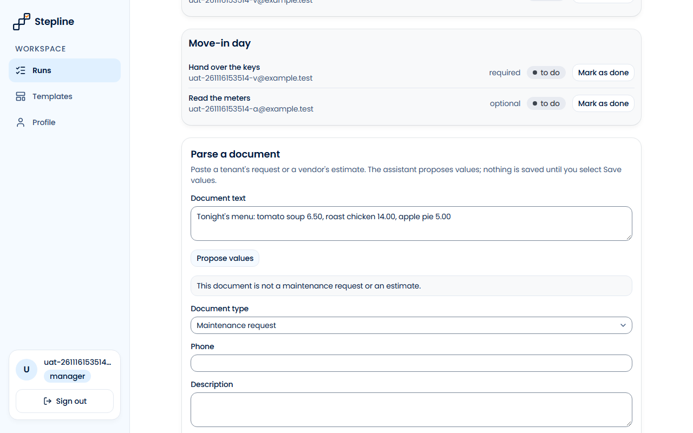
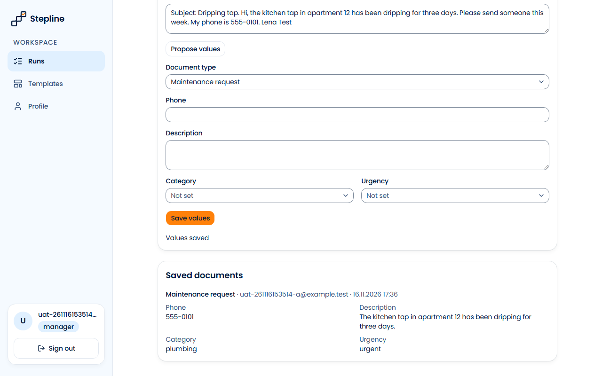

# Звіт UAT — 16.11.2026

- **Застосунок:** https://property-workflows-bravo16.vercel.app (/api/health: коміт `e2fdfde`)
- **Код тестів:** `task/docai-uat-report` @ `e2fdfde` + незакомічені зміни
- **Прогін:** 16.11.2026, 17:35 (Київ), Playwright 89.7 с; AC: 2 — PASS 2, FAIL 0, NEEDS-HUMAN 0
- **Рецензент:** `claude-haiku-5-5`; суперечки → `claude-sonnet-5-5`. Разом за розбір: $0.0044 (ціни API; за підпискою — у межах ліміту плану)
- **Прибирання:** синтетичних uat-*@example.test видалено 9, лишилось 0, їхніх рядків, що лишились: 0
- **Відео й траси:** не в git — `test-results/` локально або артефакт CI; трасу відкриває `npx playwright show-trace <trace.zip>`

| AC | Перевірки | Агент | Підсумок | Чому | Playwright | Розбір |
|---|---|---|---|---|---|---|
| AC-DOCAI-07 | пройшли | Haiku: PASS | **PASS** | R6: перевірки, агент і цитати збігаються | 11.5 с | $0.0022, 9.7 с |
| AC-DOCAI-09 | пройшли | Haiku: PASS | **PASS** | R6: перевірки, агент і цитати збігаються | 20.6 с | $0.0022, 11.0 с |

## AC-DOCAI-07 — PASS

**Тест:** AC-DOCAI-07: меню ресторану — «This document is not a maintenance request or an estimate.», жодних значень

**Критерій** (openspec/specs/document-parsing/spec.md):

> AC-DOCAI-07 — Меню ресторану
> - GIVEN менеджер запуску A відкрив свій запуск
> - WHEN A вставляє текст «Tonight's menu: tomato soup 6.50, roast chicken 14.00, apple pie 5.00» і натискає «Propose values»
> - THEN A бачить «This document is not a maintenance request or an estimate.»
> - AND жодного запропонованого значення

**Кроки:** ✔ Дано: run manager A (uat-261116153514-a@example.test) has opened their run → ✔ Коли: A pastes the restaurant menu and selects "Propose values" → ✔ Тоді: A sees "This document is not a maintenance request or an estimate." and no proposed value

**Агент (claude-haiku-5-5, PASS):** На кадрі під кнопкою «Propose values» видно рядок «This document is not a maintenance request or an estimate.», текст збігається з критерієм посимвольно. Поля «Phone» і «Description» мають порожні поля вводу; цитата в цій частині — лише їхні підписи, бо самих значень у полях немає. Поле «Document type» показує «Maintenance request» — за критерієм це форма за замовчуванням, а не запропоноване значення, тому його не оцінюю.

**Цитати агента, звірені зі сторінкою (aria):**
- «This document is not a maintenance request or an estimate.» — є на сторінці
- «Phone» — є на сторінці
- «Description» — є на сторінці

**Правило:** R6: перевірки, агент і цитати збігаються

**Відео:** `test-results/artifacts/docai-refusal-AC-DOCAI-07--7aed0-n-estimate-»-жодних-значень-chromium/video.webm` · **траса:** `test-results/artifacts/docai-refusal-AC-DOCAI-07--7aed0-n-estimate-»-жодних-значень-chromium/trace.zip` (не в git)

**Рішення PM:** ☐ приймаю · ☐ відхилення від вимог (issue «Відхилення від вимог: AC-DOCAI-07 — …») · @login: ____

## AC-DOCAI-09 — PASS

**Тест:** AC-DOCAI-09: виправлене значення збережено лише після «Save values» — до того в запуску нічого

**Критерій** (openspec/specs/document-parsing/spec.md):

> AC-DOCAI-09 — Виправлене значення збережено лише після «Save values»
> - GIVEN менеджер запуску A отримав у своєму запуску запропоновані значення листа про кран, що капає
> - WHEN A змінює urgency на urgent і натискає «Save values»
> - THEN сторінка запуску показує збережений документ із phone 555-0101 і urgency urgent
> - AND доки A не натиснув «Save values», у запуску не було збережених значень

**Кроки:** ✔ Дано: run manager A (uat-261116153514-a@example.test) has received proposed values of the dripping-tap email in their run → ✔ Коли: A changes urgency to urgent and selects "Save values" → ✔ Тоді: the run page shows the saved document with phone 555-0101 and urgency urgent

**Агент (claude-haiku-5-5, PASS):** На кадрі видно розділ «Saved documents» з документом «Maintenance request» від uat-261116153514-a@example.test. У ньому телефон 555-0101 (мітка «Phone») і урґентність urgent (мітка «Urgency»). Поле Urgency у верхній формі показує «Not set», а над кнопкою «Save values» є напис «Values saved». Частини з розділу «Не з кадрів» не оцінювалися.

**Цитати агента, звірені зі сторінкою (aria):**
- «Saved documents» — є на сторінці
- «555-0101» — є на сторінці
- «urgent» — є на сторінці

**Правило:** R6: перевірки, агент і цитати збігаються

**Відео:** `test-results/artifacts/docai-confirm-before-save--601d9--—-до-того-в-запуску-нічого-chromium/video.webm` · **траса:** `test-results/artifacts/docai-confirm-before-save--601d9--—-до-того-в-запуску-нічого-chromium/trace.zip` (не в git)

**Рішення PM:** ☐ приймаю · ☐ відхилення від вимог (issue «Відхилення від вимог: AC-DOCAI-09 — …») · @login: ____

## Як читати підсумок

- **PASS** — автоматичні перевірки пройшли, агент-рецензент погодився з кадром, а кожну його цитату знайдено на сторінці.
- **FAIL** — впала автоматична перевірка. Агент цього не перекриває: невидимі вади (буфер обміну, база) він на кадрі не побачить.
- **NEEDS-HUMAN** — перевірки зелені, але агент не погодився або його цитати немає на сторінці. Часто це слабкий тест або розбіжність між текстом AC і тестом — питання до PM, а не обов'язково вада продукту.

Правила: R1: перевірка впала — FAIL завжди, агент не перекриває; R2: немає вердикту агента або кадру; R3: перевірки пройшли, агент не погоджується — вирішує людина; R4: цитати агента немає на сторінці (aria) — не підтверджено; R5: помилка сторінки або 5xx під час сценарію; R6: перевірки, агент і цитати збігаються.
