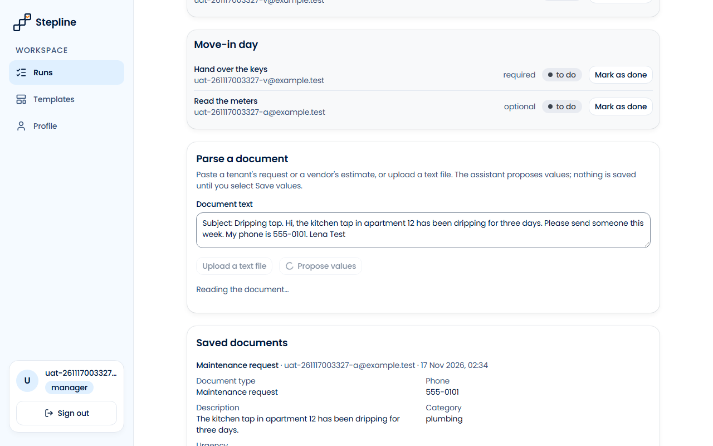
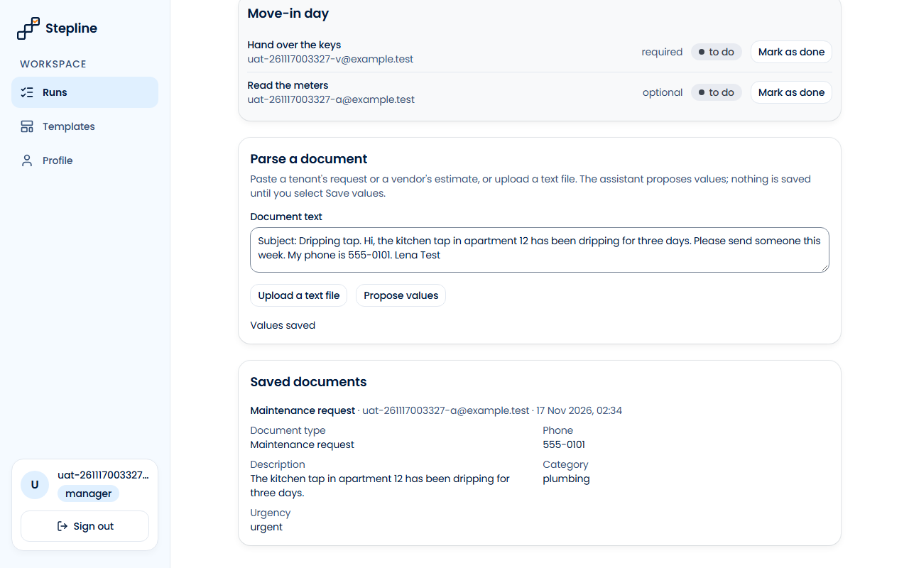
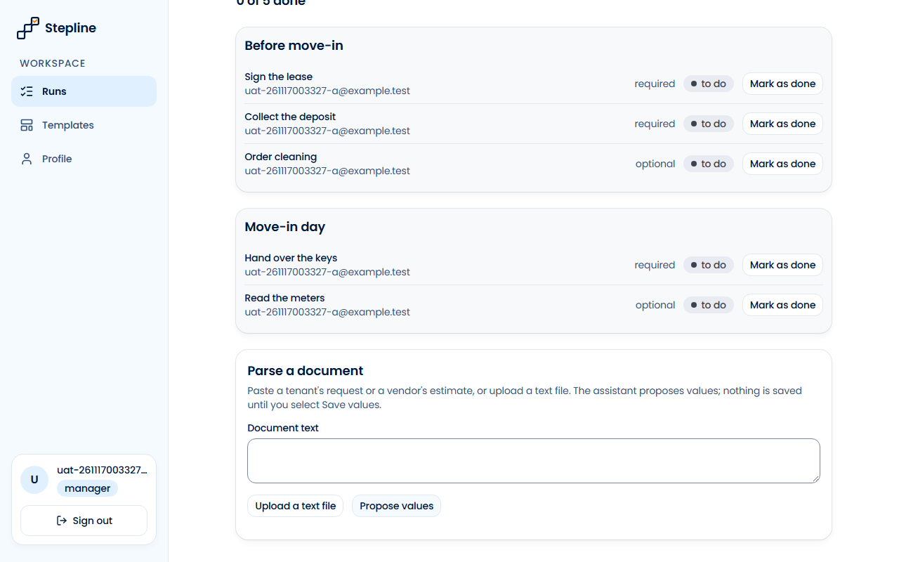
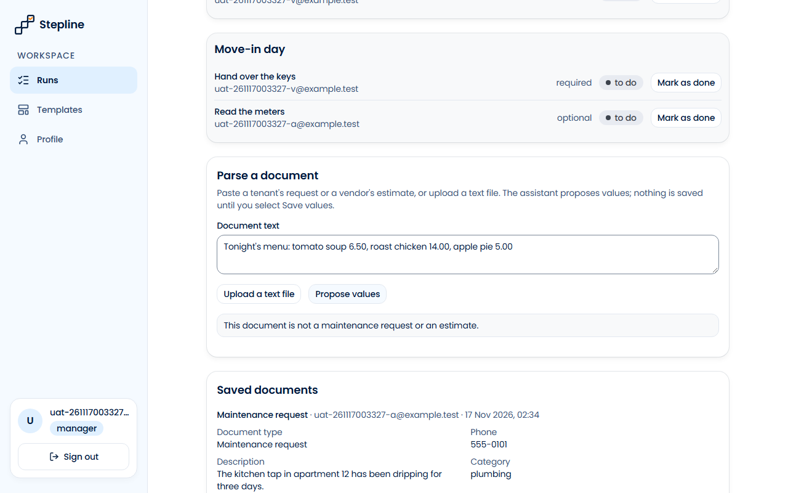
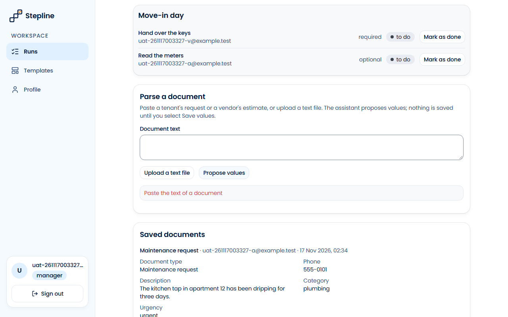
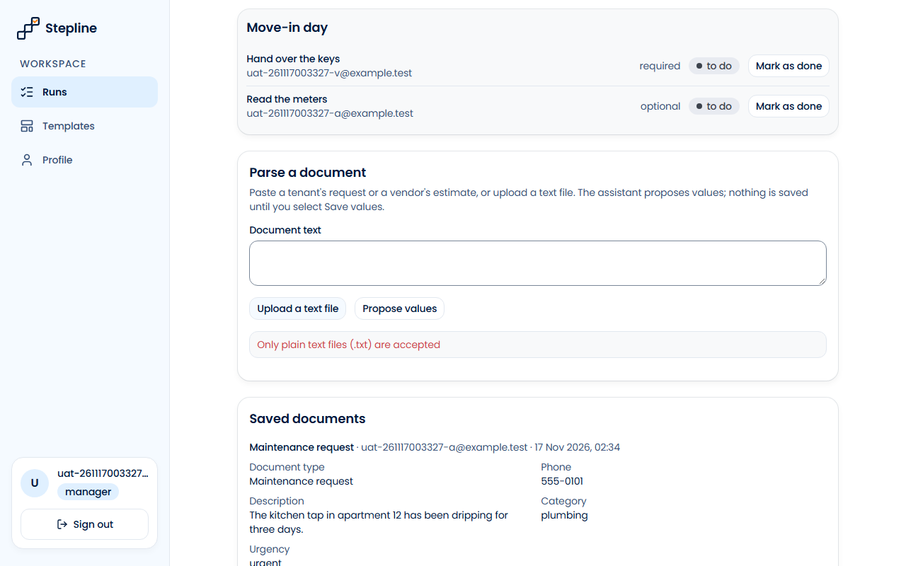

# Звіт UAT — 17.11.2026

- **Застосунок:** https://property-workflows-bravo16.vercel.app (/api/health: коміт `0d0e186`)
- **Код тестів:** `task/uat-docai-pm-criteria` @ `0d0e186` + незакомічені зміни
- **Прогін:** 17.11.2026, 02:33 (Київ), Playwright 120.6 с; AC: 6 — PASS 6, FAIL 0, NEEDS-HUMAN 0
- **Рецензент:** `claude-haiku-5-5`; суперечки → `claude-sonnet-5-5`. Разом за розбір: $0.1110 (ціни API; за підпискою — у межах ліміту плану)
- **Прибирання:** синтетичних uat-*@example.test видалено 9, лишилось 0, їхніх рядків, що лишились: 0
- **Відео й траси:** не в git — `test-results/` локально або артефакт CI; трасу відкриває `npx playwright show-trace <trace.zip>`

| AC | Перевірки | Агент | Підсумок | Чому | Playwright | Розбір |
|---|---|---|---|---|---|---|
| AC-DOCAI-03 | пройшли | Haiku: NEEDS-HUMAN, Sonnet: PASS | **PASS** | R6: перевірки, агент і цитати збігаються | 10.9 с | $0.0340, 20.2 с |
| AC-DOCAI-04 | пройшли | Haiku: PASS | **PASS** | R6: перевірки, агент і цитати збігаються | 16.8 с | $0.0029, 13.2 с |
| AC-DOCAI-05 | пройшли | Haiku: NEEDS-HUMAN, Sonnet: PASS | **PASS** | R6: перевірки, агент і цитати збігаються | 11.3 с | $0.0355, 23.0 с |
| AC-DOCAI-09 | пройшли | Haiku: PASS | **PASS** | R6: перевірки, агент і цитати збігаються | 10.7 с | $0.0024, 10.7 с |
| AC-DOCAI-11 | пройшли | Haiku: NEEDS-HUMAN, Sonnet: PASS | **PASS** | R6: перевірки, агент і цитати збігаються | 8.2 с | $0.0339, 23.0 с |
| AC-DOCAI-12 | пройшли | Haiku: PASS | **PASS** | R6: перевірки, агент і цитати збігаються | 6.0 с | $0.0024, 10.3 с |

## AC-DOCAI-03 — PASS

**Тест:** AC-DOCAI-03: поки AI читає — «Reading the document…», «Propose values» вимкнена, жодного значення

**Критерій** (requirements/59-parse-a-document-confirm-values.md):

> AC-DOCAI-03: Given run manager A who has pasted a text on the page of a run. When A chooses "Propose values" and the AI is still working. Then the block shows "Reading the document…", the button "Propose values" is disabled, and no value is shown.

**Кроки:** ✔ Дано: run manager A (uat-261117003327-a@example.test) has pasted a text on the page of their run → ✔ Коли: A selects "Propose values" and the AI is still working → ✔ Тоді: the block shows "Reading the document…", "Propose values" is disabled, and no value is shown

**Агент (claude-sonnet-5-5, PASS):** Під текстовим полем видно «Reading the document…». Кнопка «Propose values» сіра, зі спінером, тобто вимкнена. Нижче є блок «Saved documents» із раніше збереженим документом — це окремий блок, не пропозиція значень.

Haiku сказав NEEDS-HUMAN, тож розбір повторив Sonnet; рішення агента — за Sonnet.

**Цитати агента, звірені зі сторінкою (aria):**
- «Reading the document…» — є на сторінці
- «Propose values» — є на сторінці

**Правило:** R6: перевірки, агент і цитати збігаються

**Відео:** `test-results/artifacts/docai-reading-AC-DOCAI-03--8807f-»-вимкнена-жодного-значення-chromium/video.webm` · **траса:** `test-results/artifacts/docai-reading-AC-DOCAI-03--8807f-»-вимкнена-жодного-значення-chromium/trace.zip` (не в git)

**Рішення PM:** ☐ приймаю · ☐ відхилення від вимог (issue «Відхилення від вимог: AC-DOCAI-03 — …») · @login: ____

## AC-DOCAI-04 — PASS

**Тест:** AC-DOCAI-04: виправлене значення збережено лише після «Save values» — до того в запуску нічого

**Критерій** (requirements/59-parse-a-document-confirm-values.md):

> AC-DOCAI-04: Given run manager A with Document type "Maintenance request", Phone "555-0101", Category "plumbing" and Urgency "not urgent" proposed in the block. When A changes Urgency to "urgent" and chooses "Save values". Then the page of the run shows one saved record with Document type "Maintenance request", Phone "555-0101", Category "plumbing" and Urgency "urgent", the email of A and the date and time of the confirmation.

**Кроки:** ✔ Дано: run manager A (uat-261117003327-a@example.test) has received proposed values of the dripping-tap email in their run → ✔ Коли: A changes urgency to urgent and selects "Save values" → ✔ Тоді: the run page shows one saved record: Maintenance request, phone 555-0101, urgency urgent, A's email and the time

**Агент (claude-haiku-5-5, PASS):** На кадрі в блоці «Saved documents» видно один запис із Document type «Maintenance request», Phone «555-0101», Category «plumbing», Urgency «urgent», email uat-261117003327-a@example.test і датою/часом «17 Nov 2026, 02:34», а поруч напис «Values saved». Текст пропозиції ще видно в полі «Document text» над блоком, але критерій вимагає порожнього блоку пропозицій після збереження — це перевіряють автоматичні перевірки, тому тут не оцінюю.

**Цитати агента, звірені зі сторінкою (aria):**
- «Saved documents» — є на сторінці
- «Document type» — є на сторінці
- «Maintenance request» — є на сторінці
- «Phone» — є на сторінці
- «555-0101» — є на сторінці
- «Category» — є на сторінці
- «plumbing» — є на сторінці
- «Urgency» — є на сторінці
- «urgent» — є на сторінці
- «Maintenance request · uat-261117003327-a@example.test · 17 Nov 2026, 02:34» — є на сторінці

**Правило:** R6: перевірки, агент і цитати збігаються

**Відео:** `test-results/artifacts/docai-confirm-before-save--69c41--—-до-того-в-запуску-нічого-chromium/video.webm` · **траса:** `test-results/artifacts/docai-confirm-before-save--69c41--—-до-того-в-запуску-нічого-chromium/trace.zip` (не в git)

**Рішення PM:** ☐ приймаю · ☐ відхилення від вимог (issue «Відхилення від вимог: AC-DOCAI-04 — …») · @login: ____

## AC-DOCAI-05 — PASS

**Тест:** AC-DOCAI-05: «Discard» — блок знову порожній, збереженого запису немає

**Критерій** (requirements/59-parse-a-document-confirm-values.md):

> AC-DOCAI-05: Given run manager A with values proposed in the block. When A chooses "Discard". Then the block is empty again and the page of the run shows no saved record.

**Кроки:** ✔ Дано: run manager A (uat-261117003327-a@example.test) has values proposed in the block of a run without saved records → ✔ Коли: A selects "Discard" → ✔ Тоді: the block is empty again and the run page shows no saved record

**Агент (claude-sonnet-5-5, PASS):** На кадрі блок «Parse a document» з порожнім полем «Document text» і кнопками «Upload a text file» та «Propose values». Під блоком більше немає ні форми зі значеннями, ні картки «Saved documents»; сторінка закінчується блоком.

Haiku сказав NEEDS-HUMAN, тож розбір повторив Sonnet; рішення агента — за Sonnet.

**Цитати агента, звірені зі сторінкою (aria):**
- «Document text» — є на сторінці
- «Upload a text file» — є на сторінці
- «Propose values» — є на сторінці
- «Parse a document» — є на сторінці

**Правило:** R6: перевірки, агент і цитати збігаються

**Відео:** `test-results/artifacts/docai-discard-AC-DOCAI-05--37a3a-ій-збереженого-запису-немає-chromium/video.webm` · **траса:** `test-results/artifacts/docai-discard-AC-DOCAI-05--37a3a-ій-збереженого-запису-немає-chromium/trace.zip` (не в git)

**Рішення PM:** ☐ приймаю · ☐ відхилення від вимог (issue «Відхилення від вимог: AC-DOCAI-05 — …») · @login: ____

## AC-DOCAI-09 — PASS

**Тест:** AC-DOCAI-09: меню ресторану — «This document is not a maintenance request or an estimate.», жодних значень

**Критерій** (requirements/59-parse-a-document-confirm-values.md):

> AC-DOCAI-09: Given run manager A and the pasted text "Tonight's menu: tomato soup 6.50, roast chicken 14.00, apple pie 5.00". When A chooses "Propose values". Then the block shows "This document is not a maintenance request or an estimate." and no value is proposed.

**Кроки:** ✔ Дано: run manager A (uat-261117003327-a@example.test) has opened their run → ✔ Коли: A pastes the restaurant menu and selects "Propose values" → ✔ Тоді: A sees "This document is not a maintenance request or an estimate." and no proposed value

**Агент (claude-haiku-5-5, PASS):** На кадрі в блоці «Parse a document» текст збігається посимвольно з критерієм: «This document is not a maintenance request or an estimate.». Під цим повідомленням немає жодної форми з пропонованими значеннями — одразу йде розділ «Saved documents» з раніше збереженим документом, а не результатом цього запуску. Частина про відсутність пропозиції підтверджена відсутністю елементів на кадрі, тому цитата порожня.

**Цитати агента, звірені зі сторінкою (aria):**
- «This document is not a maintenance request or an estimate.» — є на сторінці

**Правило:** R6: перевірки, агент і цитати збігаються

**Відео:** `test-results/artifacts/docai-refusal-AC-DOCAI-09--ff62e-n-estimate-»-жодних-значень-chromium/video.webm` · **траса:** `test-results/artifacts/docai-refusal-AC-DOCAI-09--ff62e-n-estimate-»-жодних-значень-chromium/trace.zip` (не в git)

**Рішення PM:** ☐ приймаю · ☐ відхилення від вимог (issue «Відхилення від вимог: AC-DOCAI-09 — …») · @login: ____

## AC-DOCAI-11 — PASS

**Тест:** AC-DOCAI-11: порожнє поле чи лише пробіли — «Paste the text of a document», жодного значення

**Критерій** (requirements/59-parse-a-document-confirm-values.md):

> AC-DOCAI-11: Given run manager A with an empty text box or only spaces in it. When A chooses "Propose values". Then the block shows "Paste the text of a document" and no value is proposed.

**Кроки:** ✔ Дано: run manager A (uat-261117003327-a@example.test) has only spaces in the text box → ✔ Коли: A selects "Propose values" → ✔ Тоді: the block shows "Paste the text of a document" and no value is proposed

**Агент (claude-sonnet-5-5, PASS):** У блоці «Parse a document» під кнопками видно повідомлення «Paste the text of a document», форми із запропонованими значеннями немає. Нижче є розділ «Saved documents» із раніше збереженим документом, але це не пропозиція значень.

Haiku сказав NEEDS-HUMAN, тож розбір повторив Sonnet; рішення агента — за Sonnet.

**Цитати агента, звірені зі сторінкою (aria):**
- «Paste the text of a document» — є на сторінці
- «Paste the text of a document» — є на сторінці

**Правило:** R6: перевірки, агент і цитати збігаються

**Відео:** `test-results/artifacts/docai-empty-text-AC-DOCAI--6e8d9--document»-жодного-значення-chromium/video.webm` · **траса:** `test-results/artifacts/docai-empty-text-AC-DOCAI--6e8d9--document»-жодного-значення-chromium/trace.zip` (не в git)

**Рішення PM:** ☐ приймаю · ☐ відхилення від вимог (issue «Відхилення від вимог: AC-DOCAI-11 — …») · @login: ____

## AC-DOCAI-12 — PASS

**Тест:** AC-DOCAI-12: «photo.png» кнопкою «Upload a text file» — «Only plain text files (.txt) are accepted», жодного значення

**Критерій** (requirements/59-parse-a-document-confirm-values.md):

> AC-DOCAI-12: Given run manager A. When A uploads the file "photo.png" with "Upload a text file". Then the block shows "Only plain text files (.txt) are accepted" and no value is proposed.

**Кроки:** ✔ Дано: run manager A (uat-261117003327-a@example.test) has opened their run → ✔ Коли: A uploads the file "photo.png" with "Upload a text file" → ✔ Тоді: the block shows "Only plain text files (.txt) are accepted" and no value is proposed

**Агент (claude-haiku-5-5, PASS):** На кадрі в блоці «Parse a document» видно точний текст помилки «Only plain text files (.txt) are accepted» червоним кольором, а поле «Document text» порожнє. Форми з запропонованими значеннями під блоком не видно; нижче є розділ «Saved documents» з раніше збереженим документом, але це не пропозиція, а вже збережений запис. Частина «a plain .txt file afterwards is read into the text box» не з кадрів, тому не оцінювалась.

**Цитати агента, звірені зі сторінкою (aria):**
- «Only plain text files (.txt) are accepted» — є на сторінці
- «Document text» — є на сторінці
- «Parse a document» — є на сторінці

**Правило:** R6: перевірки, агент і цитати збігаються

**Відео:** `test-results/artifacts/docai-text-file-only-AC-DO-1f6b7--accepted»-жодного-значення-chromium/video.webm` · **траса:** `test-results/artifacts/docai-text-file-only-AC-DO-1f6b7--accepted»-жодного-значення-chromium/trace.zip` (не в git)

**Рішення PM:** ☐ приймаю · ☐ відхилення від вимог (issue «Відхилення від вимог: AC-DOCAI-12 — …») · @login: ____

## Як читати підсумок

- **PASS** — автоматичні перевірки пройшли, агент-рецензент погодився з кадром, а кожну його цитату знайдено на сторінці.
- **FAIL** — впала автоматична перевірка. Агент цього не перекриває: невидимі вади (буфер обміну, база) він на кадрі не побачить.
- **NEEDS-HUMAN** — перевірки зелені, але агент не погодився або його цитати немає на сторінці. Часто це слабкий тест або розбіжність між текстом AC і тестом — питання до PM, а не обов'язково вада продукту.

Правила: R1: перевірка впала — FAIL завжди, агент не перекриває; R2: немає вердикту агента або кадру; R3: перевірки пройшли, агент не погоджується — вирішує людина; R4: цитати агента немає на сторінці (aria) — не підтверджено; R5: помилка сторінки або 5xx під час сценарію; R6: перевірки, агент і цитати збігаються.
